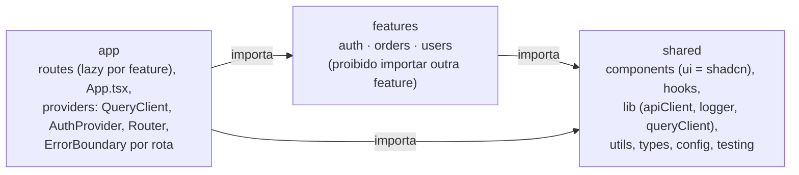

# Padrão de Arquitetura e Engenharia — React 19 + Vite + TypeScript + Tailwind + shadcn/ui

Versão 1.0 · 30/10/2026 · Padrão obrigatório para todo sistema novo. Este arquivo deve ficar na raiz do repositório e ser referenciado em `AGENTS.md`/`CLAUDE.md`.

## Como usar este documento

Todo sistema novo nasce deste padrão e só entra em produção quando passa nos gates da seção "Definition of Done". Nenhuma regra marcada **MUST** pode ser ignorada; uma exceção exige um ADR (Architecture Decision Record) aprovado por outro desenvolvedor e registrado no repositório.

| Nível | Significado | Quem pode abrir exceção |
| --- | --- | --- |
| **MUST** | Obrigatório. O CI bloqueia o merge se falhar. | Ninguém sem ADR aprovado |
| **SHOULD** | Padrão esperado. Desvio precisa de justificativa escrita no PR. | O revisor do PR |
| **MAY** | Recomendado quando fizer sentido. | O autor |

Stack fixo: React 19 + Vite + TypeScript (strict) + Tailwind CSS + shadcn/ui; estado de servidor com TanStack Query v5; estado de autenticação com Context (AuthProvider). Tudo que não está nessa lista precisa de ADR para entrar.

As regras foram cruzadas com fontes primárias abertas em 30/10/2026: OWASP Top 10:2025 e OWASP Cheat Sheet Series, documentação oficial do TanStack Query v5, Bulletproof React, web.dev (Core Web Vitals) e WCAG 2.2. A lista completa está na seção Fontes.

## Referências: quem seguir e o que cada um define

Este padrão não inventa regras: ele consolida o que os autores mais citados do ecossistema já estabeleceram. Quando duas fontes divergem, a oficial (documentação do projeto ou OWASP) vence.

| Referência | Área | O que este padrão adota dele |
| --- | --- | --- |
| [Alan Alickovic — Bulletproof React](https://github.com/alan2207/bulletproof-react) | Arquitetura React | Estrutura feature-based, importação unidirecional `shared → features → app`, ESLint `import/no-restricted-paths` |
| [Tanner Linsley / TkDodo — TanStack Query](https://tanstack.com/query/v5/docs/framework/react/guides/important-defaults) | Estado de servidor | Query key factories, `staleTime` explícito, invalidação por hierarquia, `queryOptions` |
| [Kent C. Dodds — Testing Trophy / Testing Library](https://testing-library.com) | Testes | Testar comportamento, não implementação; maioria dos testes na camada de integração; queries por role |
| [Dan Abramov — React core](https://react.dev) | React | Composição sobre herança, hooks sem efeitos desnecessários, estado derivado não duplicado |
| [Matt Pocock — Total TypeScript](https://www.totaltypescript.com) | TypeScript | `strict: true`, `noUncheckedIndexedAccess`, tipos derivados de schema (Zod), zero `any` |
| [Martin Fowler — Refactoring](https://refactoring.com) | Refatoração | Pequenos passos com testes verdes, Strangler Fig, dívida técnica como quadrante |
| [Michael Feathers — Working Effectively with Legacy Code](https://www.oreilly.com/library/view/working-effectively-with/0131177052/) | Refatoração | Testes de caracterização antes de tocar código sem testes |
| [Addy Osmani / web.dev — Google Chrome](https://web.dev/articles/vitals) | Performance | Core Web Vitals no p75, budgets de bundle, code splitting por rota |
| [OWASP Top 10:2025 + Cheat Sheet Series](https://owasp.org/Top10/2025/) | Segurança | Toda a seção de segurança; parâmetros de hash, cookies, CSRF, SSRF, upload |
| [Grafana k6](https://grafana.com/docs/k6/latest/) | Teste de carga | Thresholds como gate de CI, percentis p95/p99, cenários por endpoint |
| [W3C — WCAG 2.2](https://www.w3.org/WAI/WCAG22/Understanding/target-size-minimum.html) | Mobile e acessibilidade | Alvo de toque 24×24 px (AA), foco visível, contraste |

## Arquitetura do projeto

A estrutura é feature-based com importação unidirecional: código compartilhado não conhece features, features não conhecem umas às outras, e só a camada `app` monta tudo. Essa regra é aplicada pelo ESLint, não por convenção.



Dependências apontam para dentro: `app` importa `features` e `shared`; `features` importam só `shared`; `shared` nunca importa `features` ou `app`.

As setas mostram quem pode importar de quem; qualquer seta no sentido contrário ou entre duas features é erro de lint que bloqueia o merge.

```
src/
├── app/            # rotas, App.tsx, providers globais (QueryClient, AuthProvider, Router)
├── features/       # um módulo por domínio de negócio (auth, orders, users...)
│   └── orders/
│       ├── api/        # funções puras de fetch (sem React Query aqui)
│       ├── queries/    # hooks useQuery/useMutation + key factory
│       ├── components/ # UI exclusiva da feature
│       ├── hooks/
│       ├── schemas/    # Zod: validação + tipos derivados
│       ├── types/
│       └── index.ts    # única porta de entrada pública da feature
├── components/     # UI compartilhada; components/ui = shadcn (não editar à mão fora do CLI)
├── hooks/          # hooks genéricos
├── lib/            # wrappers de bibliotecas: apiClient, logger, queryClient
├── config/         # env validado (único lugar que lê import.meta.env)
├── types/          # tipos globais
├── utils/          # funções puras
└── testing/        # renderWithProviders, handlers MSW, factories
```

Regras obrigatórias:

- **MUST** — `features/*` não importa de outra feature nem de `app/`; `components|hooks|lib|utils|types` não importam de `features/` nem de `app/`. Aplicado com `import/no-restricted-paths` (zones) no ESLint, conforme o [Bulletproof React](https://github.com/alan2207/bulletproof-react/blob/master/docs/project-structure.md).
- **MUST** — Duas features que precisam conversar fazem isso via `app/` (composição) ou promovendo o código comum para `shared`. Nunca por import cruzado.
- **MUST** — Cada feature expõe apenas o que está em `index.ts`. Imports internos usam caminho direto (`@/features/orders/components/OrderTable`), não barrel files aninhados, para não quebrar o tree shaking do Vite.
- **MUST** — Alias `@/` configurado em `tsconfig.json` e `vite.config.ts` (via `vite-tsconfig-paths`). Proibido `../../../`.
- **MUST** — `src/config/env.ts` é o único arquivo que lê `import.meta.env`, valida com Zod no boot e falha rápido se faltar variável.
- **SHOULD** — Rotas com lazy loading por feature (`React.lazy` + `Suspense`), uma Error Boundary por rota.
- **SHOULD** — Componentes shadcn ficam em `components/ui` e são modificados só via CLI ou com comentário `// MODIFIED:` explicando o motivo.
- **MAY** — Estado de UI global (tema, sidebar) em Zustand; se o projeto não precisa, não adiciona.

## Escrita e documentação de código

Código é lido dez vezes mais do que escrito: o padrão prioriza previsibilidade sobre esperteza. A ferramenta decide o estilo (Prettier + ESLint), o revisor decide a clareza.

### TypeScript

- **MUST** — `tsconfig` com `strict: true`, `noUncheckedIndexedAccess: true`, `noImplicitOverride: true`, `exactOptionalPropertyTypes: true`, `verbatimModuleSyntax: true`.
- **MUST** — Zero `any` explícito (`@typescript-eslint/no-explicit-any: error`). Dado externo chega como `unknown` e passa por Zod antes de virar tipo.
- **MUST** — Tipos de API derivados do schema (`z.infer<typeof OrderSchema>`), nunca escritos duas vezes.
- **MUST** — `type` para dados, `interface` só para contratos extensíveis de componentes. Enums de string viram `as const` + union.
- **SHOULD** — Funções públicas de `lib/` e `utils/` com tipo de retorno explícito.

### Lint e formatação

- **MUST** — ESLint flat config com `typescript-eslint` (strict-type-checked), `eslint-plugin-react-hooks`, `eslint-plugin-jsx-a11y`, `eslint-plugin-import` e `@tanstack/eslint-plugin-query`. Prettier com `prettier-plugin-tailwindcss` (ordena classes).
- **MUST** — Husky + lint-staged rodam `tsc --noEmit`, lint e Prettier no pre-commit; o CI repete tudo. Warning conta como erro no CI (`--max-warnings 0`).

### Convenções de nomes

| Elemento | Convenção | Exemplo |
| --- | --- | --- |
| Componente e arquivo de componente | PascalCase | `OrderTable.tsx` |
| Hook | `use` + camelCase | `useOrders.ts` |
| Função, variável, pasta | camelCase / kebab-case | `formatCurrency`, `order-details/` |
| Constante global | UPPER\_SNAKE | `MAX_UPLOAD_MB` |
| Schema Zod | PascalCase + `Schema` | `CreateOrderSchema` |
| Teste | mesmo nome + `.test.tsx` ao lado do arquivo | `OrderTable.test.tsx` |
| Booleano | prefixo `is`, `has`, `can`, `should` | `isLoading`, `canEdit` |
| Handler | `handle` + evento; prop `on` + evento | `handleSubmit`, `onSubmit` |

### Componentes e hooks

- **MUST** — Um componente exportado por arquivo; máximo de \~200 linhas, acima disso quebra em subcomponentes ou extrai hook.
- **MUST** — Lógica de dados fica em hooks (`useOrders`), componente só renderiza. Componente de página (`app/routes`) não contém regra de negócio.
- **MUST** — Sem `useEffect` para sincronizar estado derivado ou copiar dado do React Query para `useState`; derive na renderização ou use `select`.
- **MUST** — Props tipadas; sem spread de props desconhecidas em elementos DOM.
- **SHOULD** — Early return para estados de loading/erro/vazio antes do JSX principal.
- **SHOULD** — `cn()` (clsx + tailwind-merge) para classes condicionais; `cva` para variantes.

### Documentação

- **MUST** — README com: objetivo do sistema, como rodar em 5 comandos, variáveis de ambiente (nome, obrigatória?, exemplo), como testar, como fazer deploy, links para ADRs. Atualizado no mesmo PR que muda o comportamento.
- **MUST** — ADR (`docs/adr/NNNN-titulo.md`) para toda decisão que custa caro reverter: biblioteca nova, mudança de estrutura, exceção a este padrão. Formato: contexto, decisão, alternativas, consequências.
- **MUST** — JSDoc em funções públicas de `lib/`, `utils/` e em hooks de feature: o que faz, parâmetros não óbvios, erros que lança. Não documentar o óbvio (`/** retorna o id */`).
- **MUST** — Comentário explica o **porquê**, nunca o **o quê**. `// TODO` sempre com link de issue: `// TODO(#123): ...`.
- **MUST** — Conventional Commits (`feat:`, `fix:`, `refactor:`, `test:`, `docs:`, `chore:`), validados por commitlint. Changelog gerado a partir deles.
- **SHOULD** — `CONTRIBUTING.md` apontando para este documento e `docs/architecture.md` com o diagrama atual de módulos.
- **MAY** — Storybook para `components/` compartilhados quando houver mais de \~15 componentes próprios.

## Estado e dados: TanStack Query v5 + AuthProvider

Estado de servidor vive só no React Query; estado de UI em `useState`/Zustand; estado de filtro/paginação na URL; estado de formulário no react-hook-form. Nenhum dado é copiado de um balde para outro.

| Tipo de estado | Onde mora | Ferramenta | Nunca |
| --- | --- | --- | --- |
| Servidor (dados da API) | Cache do QueryClient | TanStack Query v5 (5.104 em out/2026) | Copiar para `useState`, Context ou Zustand |
| UI local (modal aberto, aba ativa) | Componente | `useState` / `useReducer` | Colocar no React Query |
| UI global (tema, sidebar) | Store pequena | Zustand (só se necessário) | Virar "estado global de tudo" |
| Filtros, paginação, ordenação | URL (search params) | `nuqs` com parsers tipados | `useState` perdido no refresh |
| Formulário | react-hook-form | `zodResolver` + shadcn `Field`/`Controller` | Guardar valores do form no React Query |
| Autenticação (usuário, status) | Context fino | `AuthProvider` alimentado por `useQuery(authKeys.me())` | Duplicar o usuário fora da query |

### QueryClient global (MUST)

```ts
// src/lib/queryClient.ts
export const queryClient = new QueryClient({
  defaultOptions: {
    queries: {
      staleTime: 60_000,            // > 0 obrigatório; TkDodo recomenda >= 20 s
      gcTime: 5 * 60_000,           // default da lib
      retry: (count, err) => !(isHttpError(err) && err.status < 500) && count < 3,
      refetchOnWindowFocus: true,   // manter defaults ligados
      refetchOnReconnect: true,
      throwOnError: false,          // opt-in por query ou via useSuspenseQuery
    },
    mutations: { retry: 0 },
  },
});
```

Por que: por padrão o React Query considera tudo stale (`staleTime: 0`) e refaz fetch em mount, foco e reconexão; a documentação oficial recomenda ajustar `staleTime` em vez de desligar os refetches ([Important Defaults](https://tanstack.com/query/v5/docs/framework/react/guides/important-defaults)). Erros 4xx não devem tentar 3 vezes.

### Query keys e queryOptions (MUST)

```ts
// src/features/orders/queries.ts
export const orderKeys = {
  all: ['orders'] as const,
  lists: () => [...orderKeys.all, 'list'] as const,
  list: (filters: OrderFilters) => [...orderKeys.lists(), filters] as const,
  details: () => [...orderKeys.all, 'detail'] as const,
  detail: (id: string) => [...orderKeys.details(), id] as const,
};

export const orderListOptions = (filters: OrderFilters) =>
  queryOptions({ queryKey: orderKeys.list(filters), queryFn: () => fetchOrders(filters) });
```

- **MUST** — Uma key factory por feature, colocada em `features/<x>/queries.ts`, do genérico para o específico ([TkDodo, Effective React Query Keys](https://tkdodo.eu/blog/effective-react-query-keys)). Keys são sempre arrays; tudo que a `queryFn` usa entra na key.
- **MUST** — Toda query reutilizável é definida com `queryOptions()` e consumida por `useQuery`, `useSuspenseQuery`, `useQueries` ou `queryClient.query()` ([Query Options](https://tanstack.com/query/v5/docs/framework/react/guides/query-options)).
- **MUST** — Após mutação: `invalidateQueries({ queryKey: orderKeys.lists() })` (key pai da feature). Proibido `invalidateQueries()` sem key como rotina.
- **MUST** — Query dependente usa `skipToken` (tipado) ou `enabled: !!id`; nunca `queryFn` que retorna `undefined`.
- **MUST** — Paginação com `placeholderData: keepPreviousData`; mutações usam `isPending` (v5). Proibidos `onSuccess` em `useQuery`, `cacheTime`, `prefetchQuery`/`ensureQueryData` (depreciados, removidos na v6; usar `queryClient.query`).
- **MUST** — `@tanstack/eslint-plugin-query` com `flat/recommended-strict` bloqueando o CI (`exhaustive-deps`, `no-unstable-deps`, `prefer-query-options`).
- **MUST** — Sem `Date.now()`, objetos novos por render ou valores instáveis dentro de keys.
- **SHOULD** — Otimismo via UI (`variables` enquanto `isPending`) quando só um lugar mostra o resultado; via cache (`onMutate` + rollback em `onError` + `invalidateQueries` em `onSettled`) quando várias partes da tela refletem a mudança ([Optimistic Updates](https://tanstack.com/query/v5/docs/framework/react/guides/optimistic-updates)).
- **SHOULD** — Prefetch no loader da rota (`queryClient.query({ ...opts, staleTime: 'static' })`) para evitar waterfall e flash de loading.
- **MAY** — `useSuspenseQuery` com `QueryErrorResetBoundary` + Error Boundary acima; `persistQueryClient` (gcTime ≥ maxAge de 24 h) só para apps offline-first.

### AuthProvider + cliente HTTP (MUST)

1. `src/lib/apiClient.ts`: `ky.extend({ prefixUrl, timeout: 10_000, retry: { limit: 2 }, hooks })`. O hook `afterResponse` trata 401 **uma única vez** (`retryCount === 0`), com refresh single-flight (uma `refreshPromise` compartilhada por todas as requisições concorrentes). Falhou o refresh: chama `logout()`.
2. `features/auth/queries.ts`: `authKeys.me()` com `staleTime: 5 * 60_000`, `retry: false`.
3. `AuthProvider` expõe `{ user, status: 'authenticated' | 'unauthenticated', login, logout }`. `user` vem **somente** de `useQuery(meQueryOptions)`; renderiza `children` só depois que a query resolve ([TkDodo, React Query and React Context](https://tkdodo.eu/blog/react-query-and-react-context)). Valor memoizado; contexto de dados separado do contexto de ações para evitar re-render em cascata.
4. `login` faz `queryClient.setQueryData(authKeys.me(), user)`; `logout` faz `await queryClient.cancelQueries(); queryClient.clear(); navigate('/login')`.
5. Route guards são UX, não segurança: o backend autoriza cada requisição. No React Router, "parent loaders cannot protect child loaders" — cada loader protegido checa a si mesmo ([React Router](https://reactrouter.com/start/framework/data-loading)).
6. Cliente HTTP: `openapi-fetch` (6 kB, tipado a partir do OpenAPI) ou `ky` (hooks, retry, timeout); axios (32 kB) só por ADR. Respostas de endpoints sem spec confiável passam por Zod na borda.

### Versões do stack (out/2026)

Stack padrão em out/2026: React 19.3.1, Vite 8.3 (Rolldown), TypeScript 7.0 (compilador em Go; a 6.0 foi a última em JavaScript), Tailwind 4.3.3, TanStack Query 5.105, React Router 8.5, Zod 4.6, Node 24 (Maintenance LTS) / 26 (Active LTS); shadcn/ui usa Base UI como primitivo padrão desde jul/2026 (Radix ainda suportado via `shadcn init -b radix`). React Query v5 exige React ≥ 18.0, então todas as regras valem também para sistemas legados em React 18, que seguem o roteiro de migração da seção "Itens adicionais". Com React 19, Context usa a forma `<Ctx value>` e `ref` é prop comum (sem `forwardRef`).

## Testes e review de código

A estratégia é o "Testing Trophy" de Kent C. Dodds: tipagem e lint sempre ligados, poucos testes unitários para lógica pura, a maioria dos testes de integração (componente real + providers reais + rede mockada com MSW) e uma camada fina de E2E com Playwright nas jornadas críticas. Cobertura 100% obrigatória é proibida: Dodds a chama de "a really bad idea" fora de bibliotecas pequenas ([Write tests. Not too many. Mostly integration.](https://kentcdodds.com/blog/write-tests)).

| Camada | Ferramenta (versão out/2026) | O que cobre | Quantidade |
| --- | --- | --- | --- |
| Estática | `tsc --noEmit` + ESLint (testing-library, jest-dom, playwright, tanstack-query) | Tipos, regras, imports | Sempre |
| Unitária | Vitest 5.x | `utils/`, `lib/`, schemas Zod, reducers | Poucos, só lógica não trivial |
| Integração (componente) | Vitest + React Testing Library + user-event + MSW 3.0 | Feature renderizada com QueryClient, AuthProvider e Router reais; rede mockada | A maioria |
| E2E | Playwright 1.64 | Login, fluxo principal de cada feature, caminho de pagamento/crítico | Poucos, estáveis |
| Acessibilidade | `vitest-axe` (componente) + `@axe-core/playwright` (rota) | WCAG A/AA automatizável | 1 por rota nova |
| Visual | Playwright `toHaveScreenshot` (baseline gerada em CI/Docker) ou Chromatic | Regressão visual de `components/` | Opcional |
| Mutação | StrykerJS (runner vitest, incremental) | Qualidade das asserções em `lib/` e `utils/` | Semanal, fora do PR |

### Regras de teste (MUST)

- Cobertura global mínima: linhas/funções/statements ≥ 80 %, branches ≥ 70 %; `src/lib/**` e `src/utils/**` com 100 %. Thresholds no `vitest.config.ts` (`coverage.thresholds`, provider `v8`) e nunca diminuem (`autoUpdate: true` como catraca). Excluir `*.stories.*`, `src/testing/**`, clientes gerados e `main.tsx`.
- Setup único em `src/testing/setup.ts`: jest-dom, vitest-axe, MSW com `server.listen({ onUnhandledRequest: 'error' })` (ou `onUnhandledFrame` em MSW ≥ 2.14), `resetHandlers()` após cada teste, `close()` no final ([MSW Node](https://mswjs.io/docs/integrations/node)). Requisição sem handler falha o teste.
- `renderWithProviders()` em `src/testing/`: QueryClient **novo por teste** com `retry: false` e `gcTime: Infinity`, AuthProvider com usuário injectável, MemoryRouter; retorna `{ user: userEvent.setup(), queryClient }` ([TanStack testing](https://tanstack.com/query/v5/docs/framework/react/guides/testing)). Nunca definir `retry` direto em `useQuery` no código de produção (sobrescreve o default de teste); usar `setQueryDefaults`.
- Queries por prioridade da Testing Library: `getByRole` com `name` primeiro, `getByLabelText`, `getByText`; `getByTestId` só com justificativa no PR. Componente shadcn que não é encontrável por role é bug de acessibilidade, não motivo para `data-testid`.
- `find*` para assíncrono, `query*` só para ausência, sem efeitos colaterais dentro de `waitFor`, sem `act` manual, `userEvent` em vez de `fireEvent`; com fake timers, `userEvent.setup({ advanceTimers: vi.advanceTimersByTime })` ([Common mistakes with RTL](https://kentcdodds.com/blog/common-mistakes-with-react-testing-library)).
- Mockar só a borda de rede (MSW). Proibido `vi.mock` de hooks do React Query, do AuthProvider ou do apiClient. Handlers em `src/testing/handlers.ts`, reutilizados por Storybook e Playwright.
- Playwright: `fullyParallel: true`, `forbidOnly` em CI, `retries: 2` em CI, `trace: 'on-first-retry'`, `reporter: 'blob'` em CI com `merge-reports`, projeto `setup` que loga uma vez e salva `storageState` em `playwright/.auth/` (no `.gitignore`). Locators por role, asserções web-first (`await expect(locator).toBeVisible()`), `page.route` para APIs de terceiros. Proibidos `page.waitForTimeout` e `expect(await locator.isVisible())` ([Playwright Best Practices](https://playwright.dev/docs/best-practices)).
- Teste flaky é colocado em `test.fixme` com issue em até 24 h; não fica tentando até passar.
- Snapshot de árvore DOM é proibido; snapshot só de saída de função pura ou de fingerprint de violações axe.

### Code review (MUST)

- Padrão do Google: aprovar quando o PR "definitely improves the overall code health", mesmo sem ser perfeito; fatos técnicos vencem opinião; estilo é decidido pela ferramenta, não pelo revisor; comentário opcional começa com `Nit:` ([Standard of Code Review](https://google.github.io/eng-practices/review/reviewer/standard.html)).
- Tamanho: \~200 linhas alteradas é o alvo; até 400 linhas por sessão de review (estudo SmartBear/Cisco); acima de 1000 linhas o PR é dividido, salvo deleção ou refactor automatizado combinado antes ([Small CLs](https://google.github.io/eng-practices/review/developer/small-cls.html)). Lockfiles, snapshots e código gerado não contam.
- Primeira resposta em até 1 dia útil ([Speed of Code Reviews](https://google.github.io/eng-practices/review/reviewer/speed.html)); SHOULD em 4 h para PRs ≤ 200 linhas.
- Refactor e feature em PRs separados. Toda mudança de lógica traz teste no mesmo PR.
- `CODEOWNERS` + regra "Require review from Code Owners"; 1 aprovação para código comum, 2 para `features/auth`, pagamentos e migrações; aprovações antigas são descartadas a cada push.
- Trunk-based: branch vive no máximo 2 dias úteis, squash merge com título em Conventional Commits validado por commitlint. GitFlow não é usado.
- Review por IA (CodeRabbit, Copilot, Claude) roda antes do humano e não conta como aprovação: um artigo de 2026 estima 15–30 % de comentários de baixo valor sem ajuste e aponta que a IA não enxerga lógica de negócio, IDOR dependente do modelo de autorização nem race conditions entre serviços ([AI Code Review Tools 2026](https://www.kunalganglani.com/blog/ai-code-review-tools-2026-compared)). PR majoritariamente gerado por IA é declarado no template para o revisor elevar o rigor.

### Template de PR (obrigatório no repositório)

```markdown
## O que / por quê
<link da issue>

## Tipo
feat | fix | refactor | chore  ·  Breaking? sim/não  ·  Gerado majoritariamente por IA? sim/não

## Evidência de teste
- [ ] Testes de integração adicionados/atualizados
- [ ] Handlers MSW atualizados para endpoints novos
- [ ] Rota nova tem teste axe
- [ ] Screenshots light/dark + mobile (mudança de UI)

## Risco e rollout
Feature flag? Migração? Plano de rollback?

## Checklist
- [ ] tsc, lint e testes verdes localmente
- [ ] Nenhum `data-testid` onde role/label funciona
- [ ] Nenhum `retry`/`gcTime` direto em useQuery
- [ ] Nenhum `waitForTimeout` no Playwright
- [ ] README/ADR atualizados se o comportamento mudou
```

## Teste de carga e performance

Nenhuma release vai para produção sem um teste de carga média com thresholds verdes no k6 e sem o Lighthouse CI aprovando as rotas principais. O gate mínimo é `http_req_failed < 1 %` e `p(95) < 500 ms`; no frontend, LCP ≤ 2,5 s, INP ≤ 200 ms e CLS ≤ 0,1 no p75 em mobile.

### Teste de carga com Grafana k6 (v2.x, TypeScript nativo)

| Tipo | Quando roda | Forma | Duração |
| --- | --- | --- | --- |
| Smoke | Todo PR que toca API ou apiClient | 1–5 VUs | 1–2 min |
| Carga média | Antes de toda release (gate) | rampa 5 min → platô 30 min → descida 5 min | 40 min |
| Stress e spike | Antes de picos conhecidos (campanha, fechamento) | acima da média / salto súbito | 5–60 min |
| Soak | Agendado (noturno/semanal), nunca em PR | carga média por horas | 2–8 h |
| Breakpoint | Poucas vezes, para achar o limite | cresce até quebrar | variável |

Fonte da tabela: [k6 test types](https://grafana.com/docs/k6/latest/testing-guides/test-types/); a rampa ocupa 5–15 % do total e o platô ≥ 5× a rampa ([k6 average-load](https://grafana.com/docs/k6/latest/testing-guides/test-types/load-testing/)).

```ts
// load/average.ts  (k6 run load/average.ts)
import http from 'k6/http';
import { check, sleep } from 'k6';
import { SharedArray } from 'k6/data';

const users = new SharedArray('users', () => JSON.parse(open('./users.json')));

export const options = {
  stages: [{ duration: '5m', target: 100 }, { duration: '30m', target: 100 }, { duration: '5m', target: 0 }],
  summaryTrendStats: ['avg', 'med', 'p(90)', 'p(95)', 'p(99)'],
  thresholds: {
    http_req_failed: [{ threshold: 'rate<0.01', abortOnFail: true, delayAbortEval: '60s' }],
    http_req_duration: ['p(95)<500', 'p(99)<1500'],
    'http_req_duration{name:orders-list}': ['p(95)<300'],
    checks: ['rate>0.99'],
  },
};

export default function () {
  const u = users[__VU % users.length];
  const res = http.get(`${__ENV.BASE_URL}/api/orders`, { tags: { name: 'orders-list' } });
  check(res, { 'status 200': (r) => r.status === 200 });
  sleep(1);
}
```

- **MUST** — Thresholds são o gate: k6 sai com código ≠ 0 (99 em abort por threshold) e o step do CI falha ([k6 thresholds](https://grafana.com/docs/k6/latest/using-k6/thresholds/)). `check` sozinho não falha o teste; por isso o threshold em `checks`.
- **MUST** — Dados de teste via `SharedArray` (100 k linhas × 100 VUs: \~250 MB contra \~9 GB em array comum). Think time com `sleep()`. `p(99)` adicionado em `summaryTrendStats` (default só vai até p95).
- **MUST** — Versão do k6 fixada no CI (`grafana/k6:2.x`, nunca `latest`); a v2.0 removeu executores e comandos. CI com `grafana/setup-k6-action@v1` + `grafana/run-k6-action@v1`, ou container `grafana/k6`.
- **MUST** — Teste roda contra staging com dados estáveis, nunca contra produção sem aprovação formal.
- **SHOULD** — SLO em RPS usa `constant-arrival-rate` (modelo aberto; `ramping-vus` deixa respostas lentas reduzirem a taxa). Guardar o `handleSummary` JSON de cada run e comparar p95/erro com a release anterior (k6 OSS não faz diff de baseline).
- **SHOULD** — 1–2 VUs de browser (`k6 browser`, ≤ 10 % dos VUs) no teste de carga média com `browser_web_vital_lcp: ['p(75)<2500']`, `browser_web_vital_inp: ['p(75)<200']`, para medir a experiência real sob carga ([hybrid approach](https://grafana.com/docs/k6/latest/using-k6-browser/recommended-practices/hybrid-approach-to-performance/)).

### Performance de frontend

| Métrica | Alvo (p75, mobile) | Onde se mede |
| --- | --- | --- |
| LCP | ≤ 2,5 s | Campo (RUM) + Lighthouse CI |
| INP | ≤ 200 ms (200–500 precisa melhorar; > 500 ruim) | Só campo; Lighthouse usa TBT como proxy |
| CLS | ≤ 0,1 | Campo + Lighthouse CI |
| JS inicial (app shell) | ≤ 200 kB brotli | `size-limit` no CI |
| Chunk de rota lazy | ≤ 100 kB brotli | `size-limit` no CI |
| Score Lighthouse performance | ≥ 0,90 (mediana de 5 runs) | Lighthouse CI |

Os três Core Web Vitals e seus limites não mudaram desde 2024; FID foi removido em 09/09/2024 ([web.dev Vitals](https://web.dev/articles/vitals), [INP](https://web.dev/articles/inp)). A web.dev recomenda ≤ 170 kB de recursos críticos em 3G; 200 kB é a folga adotada aqui como política da casa ([Performance budgets 101](https://web.dev/articles/performance-budgets-101)).

- **MUST** — RUM com a biblioteca `web-vitals` v5 (`onLCP/onINP/onCLS`, build `attribution` em staging), enviada por `navigator.sendBeacon` com rota, `id`, `rating` e alvo da interação. Dashboard por rota e por dispositivo. Só campo aprova CWV; lab não.
- **MUST** — `lighthouserc.json` com `numberOfRuns: 5`, agregação `median-run`, `categories:performance ≥ 0.9`, `largest-contentful-paint ≤ 2500`, `cumulative-layout-shift ≤ 0.1`, `total-blocking-time ≤ 300`, `resource-summary:script:size ≤ 204800` (bytes; em `budget.json` a unidade é kB, não misturar) ([LHCI configuration](https://github.com/GoogleChrome/lighthouse-ci/blob/main/docs/configuration.md)). Nunca asserir sobre um único run.
- **MUST** — `size-limit` + `andresz1/size-limit-action` comentando o delta em cada PR; `build.chunkSizeWarningLimit: 300`.
- **MUST** — Rotas com `React.lazy` declarado no topo do módulo + `Suspense` por rota; handler de `vite:preloadError` recarregando a página; `index.html` servido com `Cache-Control: no-cache` e assets com hash em cache imutável ([Vite build](https://vite.dev/guide/build)).
- **MUST** — Imagem LCP é `` com `width/height`, `fetchpriority="high"` e nunca `loading="lazy"`; demais imagens `loading="lazy"` + `decoding="async"`, AVIF/WebP via CDN. Fontes só WOFF2, `font-display: swap`, `size-adjust` no fallback, preload apenas da fonte primária ([Optimize LCP](https://web.dev/articles/optimize-lcp), [Font best practices](https://web.dev/articles/font-best-practices)).
- **MUST** — Listas com mais de algumas centenas de linhas usam `@tanstack/react-virtual`. Filtro/ordenação pesada no cliente usa `useDeferredValue` com o filho em `memo` ([useDeferredValue](https://react.dev/reference/react/useDeferredValue)).
- **SHOULD** — Em Vite 8 (Rolldown), split de vendors via `build.rolldownOptions.output.codeSplitting.groups` (`react`, `@tanstack`, `vendor`, `common` com `minShareCount: 2`); `manualChunks` está depreciado ([Rolldown codeSplitting](https://rolldown.rs/reference/OutputOptions.codeSplitting)). Em Vite 5–7 ainda é `manualChunks`.
- **SHOULD** — Prefetch no hover/focus e no loader com `queryClient.query`; `staleTime` global ≥ 30 s para dados de leitura.

## Refatoração sem quebrar funcionalidade

Refatorar é mudar a estrutura interna sem mudar o comportamento observável, em passos pequenos, com o sistema funcionando após cada passo ([Fowler, refactoring.com](https://refactoring.com/)). Reescrita do zero é proibida como estratégia: Fowler relata que big-bang "go down in flames most of the time" ([Strangler Fig](https://martinfowler.com/bliki/StranglerFigApplication.html)) e Spolsky a chama de "the single worst strategic mistake" ([Things You Should Never Do](https://www.joelonsoftware.com/2000/04/06/things-you-should-never-do-part-i/)).

### Protocolo obrigatório (MUST)

1. **Rede de segurança primeiro.** Código sem teste é código legado (Feathers). Antes de tocar, escreva testes de caracterização que capturam o comportamento **atual** (não o desejado), mudando o mínimo possível para conseguir testá-lo ([Working Effectively with Legacy Code, resumo](https://understandlegacycode.com/blog/key-points-of-working-effectively-with-legacy-code/)). Snapshot/approval test é aceito **só** nesse papel.
2. **Um chapéu por vez.** Commit de refactor não contém mudança de comportamento; PR de refactor é separado do PR de feature (regra do Google também).
3. **Um refactoring nomeado por vez** (Extract Function, Move, Rename, Inline...), rodando `tsc --noEmit` e os testes após cada um. Vermelho = volta um passo.
4. **Mudança de interface, API ou query key = Parallel Change:** expandir (suporta velho e novo) → migrar clientes → contrair (remover o velho). Pode ir a produção em qualquer fase ([Parallel Change](https://martinfowler.com/bliki/ParallelChange.html)). Para query keys, a factory por feature faz a fase de contração virar edição de um arquivo.
5. **Troca de biblioteca ou camada de dados = Branch by Abstraction:** cria a abstração, migra os clientes para ela, constrói o novo fornecedor atrás de feature flag, compara comportamento em staging, deleta o antigo ([Branch by Abstraction](https://martinfowler.com/bliki/BranchByAbstraction.html)).
6. **Substituição de módulo ou sistema = Strangler Fig:** novas funcionalidades nascem fora do legado, com arquitetura transitória explicitada e plano de deleção.
7. **Mudança mecânica em muitos arquivos = codemod**, nunca busca-e-substitui manual: `jscodeshift` (`--dry` primeiro, `--parser=tsx`), `ast-grep` ou o codemod oficial da biblioteca (ex.: `@tanstack/react-query/build/codemods/v5/remove-overloads`). Revisar a saída e rodar Prettier/ESLint depois ([TanStack migrating to v5](https://tanstack.com/query/v5/docs/framework/react/guides/migrating-to-v5)).
8. **Gate do PR de refactor:** cobertura das linhas tocadas ≥ 80 %, duplicação ≤ 3 % no código novo (quality gate "Sonar way"), mutation score com `break` configurado no Stryker para `lib/` e `utils/`.
9. **Limpeza ao final:** flags, abstrações temporárias e código antigo são removidos na fase de contração; flag é estoque com custo de carregamento e nasce com data de expiração e tarefa de remoção ([Feature Toggles](https://martinfowler.com/articles/feature-toggles.html)).

### Quando reescrever é permitido

Somente quando (a) remendar incrementalmente já foi tentado e demonstradamente não funciona mais e (b) a reescrita ainda assim é executada como Strangler Fig entregando continuamente — nunca como um "v2" paralelo com data de corte. Exige ADR.

### Práticas contínuas (SHOULD)

- Regra do acampamento: deixar o código um pouco melhor do que encontrou, a cada PR ([Opportunistic Refactoring](https://martinfowler.com/bliki/OpportunisticRefactoring.html)).
- Refactor preparatório: antes de uma feature, deixar o código no formato que a feature precisa; Fowler relata que costuma ser mais rápido do que pular essa etapa.
- Rename, extract e move via IDE/TypeScript (`tsc` como rede de segurança), nunca por regex.

## Deterioração do contexto

O contexto de um sistema apodrece por quatro vias: imports que furam as fronteiras, código morto e dependências que ninguém remove, complexidade que cresce nos arquivos mais alterados, e documentação/decisões que ficam só na cabeça de quem saiu. A defesa é transformar cada regra em uma ferramenta que sai com código ≠ 0 no CI, mais rituais fixos de limpeza.

### Gates automáticos (MUST)

| Sinal de deterioração | Limite | Ferramenta | Fonte |
| --- | --- | --- | --- |
| Import entre features, de shared para features, de features para app | 0 | ESLint `import/no-restricted-paths` + `dependency-cruiser` regra com `$1` (feature só depende de si mesma), `severity: error` | [dependency-cruiser rules](https://github.com/sverweij/dependency-cruiser/blob/main/doc/rules-reference.md) |
| Dependência circular em runtime | 0 | `dependency-cruiser` `no-circular-at-runtime` (`viaOnly.dependencyTypesNot: ['type-only']`) | idem |
| Arquivo, export ou dependência sem uso | 0 | `knip` (modo padrão + `--production`), exit 1 em qualquer achado | [knip CI](https://knip.dev/guides/using-knip-in-ci) |
| Dev-dependency importada em `src/` | 0 | `dependency-cruiser` `not-to-dev-dep` | rules-reference |
| Complexidade cognitiva por função | ≤ 15 | `eslint-plugin-sonarjs` / SonarQube S3776 | [SonarSource](https://community.sonarsource.com/t/s3776-reason-for-the-current-default-value-of-15/127103) |
| Duplicação em código novo | ≤ 3 % | SonarQube quality gate "Sonar way" | [Sonar gates](https://docs.sonarsource.com/sonarqube-server/latest/quality-standards-administration/managing-quality-gates/introduction-to-quality-gates/) |
| Cobertura em código novo | ≥ 80 % | Vitest thresholds + Sonar | idem |
| Mutation score em `lib/` e `utils/` | ≥ 60 % falha abaixo; alvo ≥ 80 % | StrykerJS `thresholds.break` | [Stryker](https://stryker-mutator.io/docs/stryker-js/configuration/) |
| Majors atrasados (React, Node, TS, TanStack) | ≤ 1 | Renovate `config:best-practices`, majors em sequência | [Renovate](https://docs.renovatebot.com/upgrade-best-practices/) |
| Feature flags vivas | teto fixo por sistema (ex.: 10) | Sweep mensal; flag nasce com expiração | Fowler |
| `AGENTS.md` / `CLAUDE.md` | < 200 linhas | `/doctor prompt-audit` ou revisão | [Claude Code best practices](https://code.claude.com/docs/en/best-practices) |

A severidade padrão do dependency-cruiser é `warn`: toda regra que deve bloquear merge precisa de `"severity": "error"` explícito.

### Regras de código (MUST)

- Arquivo de componente ≤ \~200 linhas e função ≤ \~50 linhas são política da casa (não há número normativo nas fontes; a CodeScene usa linhas como proxy de complexidade). Estourou: extrai hook ou subcomponente.
- Hotspots (churn × tamanho) são revisados a cada sprint: "change alone is the single most important metric" para defeitos ([CodeScene](https://docs.enterprise.codescene.io/versions/4.1.4/guides/technical/hotspots.html)). Os 5 maiores recebem refactor preparatório antes de nova feature.
- `// TODO` sem issue é erro de lint. `// eslint-disable` exige comentário de justificativa na mesma linha.
- Nenhum `any`, nenhum `@ts-ignore` (só `@ts-expect-error` com motivo).

### Decisões e documentação viva (MUST)

- **ADR** numerado e imutável em `docs/adr/NNNN-titulo.md` no mesmo PR da decisão; decisão revertida é marcada como *superseded*, nunca apagada; 1–2 páginas; seções Contexto, Decisão ("Nós vamos..."), Status, Consequências ([Nygard](https://cognitect.com/blog/2011/11/15/documenting-architecture-decisions)).
- **Diagrama C4** (contexto e containers no mínimo) como código (Mermaid/Structurizr) ao lado dos ADRs, para ser diffado no PR ([C4 model](https://c4model.com/)).
- **`AGENTS.md`** na raiz (padrão da Linux Foundation, 60 k+ projetos): comandos exatos de build/teste/lint, como rodar um único teste, estilo, regras de PR, lugares onde o código engana ("`src/legacy/` ainda roda mas não copie o padrão"), decisões que não estão no repo. Não descrever arquitetura que o agente pode ler no código. Regra sem exceção vira hook/lint, não prosa ([agents.md](https://agents.md/)).
- **Tech debt register**: uma única lista, cada item com valor de negócio e classificação no quadrante de Fowler (prudente/imprudente × deliberado/inadvertido); dívida prudente em código raramente tocado pode ficar ([Technical Debt Quadrant](https://martinfowler.com/bliki/TechnicalDebtQuadrant.html)).

### Rituais com cadência (MUST)

| Ritual | Cadência | Saída |
| --- | --- | --- |
| Lockfile maintenance e triagem do Dependency Dashboard | Semanal (Renovate `:maintainLockFilesWeekly`) | PRs de dependência mergeados ou justificados |
| 20 % da capacidade para trabalho técnico (Cagan) | Toda sprint | Itens do register fechados, resultado publicado |
| Sweep de feature flags | Mensal | Flags expiradas removidas |
| Auditoria de `AGENTS.md`, README e ADRs | Trimestral e sempre que um comando mudar | Linhas obsoletas removidas |
| Revisão de hotspots e dashboard de deterioração | Por sprint | Top 5 hotspots com ação |
| Política de versão: Node só em Active/Maintenance LTS; React no máximo 1 major atrás, migração em até 12 meses | Contínuo | Node 20 é EOL desde 24/03/2026; 22.x termina em 30/04/2027 |

## Logs e observabilidade

Todo erro tem que ser localizável por um único identificador que aparece na tela do usuário, no log do backend e no evento do Sentry. Backend loga JSON estruturado com pino; frontend nunca usa `console` em produção, usa um wrapper que envia para o Sentry; nenhum dado pessoal ou segredo entra em log (OWASP + LGPD).

### Correlação ponta a ponta (MUST)

1. O `apiClient` gera `X-Request-Id = crypto.randomUUID()` por requisição e envia o header.
2. O backend (pino-http `genReqId`) reaproveita o header se vier, senão gera, e **sempre** devolve `X-Request-Id` na resposta ([pino-http](https://github.com/pinojs/pino-http/blob/master/README.md)). CORS expõe esse header (`Access-Control-Expose-Headers`).
3. Toda linha de log daquela requisição carrega `reqId` (child logger) e `trace_id`/`span_id` via `@opentelemetry/instrumentation-pino` (W3C `traceparent`, propagado pelo `browserTracingIntegration` do Sentry; `tracePropagationTargets` lista a origem da API).
4. Em resposta com erro, o `apiClient` anexa `requestId` e `traceId` ao objeto de erro; `QueryCache.onError`, `MutationCache.onError` e `beforeCapture` da ErrorBoundary fazem `scope.setTag('requestId', ...)`.
5. A UI de erro (fallback da boundary e toast) mostra **"Código de suporte: {requestId}"**.

### Backend: pino (MUST)

| Campo | Origem | Obrigatório |
| --- | --- | --- |
| `time`, `level` (numérico 10–60), `msg` | pino | Sim |
| `service`, `version` (git SHA), `env` | `base` | Sim |
| `reqId`, `method`, `url` (só path), `statusCode`, `durationMs` | pino-http | Sim na linha de acesso |
| `trace_id`, `span_id` | instrumentation-pino | Sim quando há span |
| `userId` (id interno), `sessionId` (hash) | `child()` após auth | Sim quando autenticado |
| `event` (vocabulário OWASP: `authn_login_fail`, `authz_fail`...) | código | Sim em evento de segurança |
| `err` (serializer padrão) | pino | Sim em erro |

| Nível | Uso | Produção |
| --- | --- | --- |
| `fatal` | Processo não pode continuar; flush e exit ≠ 0 | Sim, alerta imediato |
| `error` | Operação falhou (5xx, exceção não tratada) | Sim, nunca amostrado |
| `warn` | Anomalia tratada e evento de segurança (4xx de auth, validação, rate limit, retry) | Sim, nunca amostrado |
| `info` | Ciclo de vida, 1 linha de acesso por requisição, evento de negócio | Sim; rotas de alto volume podem amostrar |
| `debug` | Diagnóstico do desenvolvedor | Não |
| `trace` | Payloads | Nunca |

- `customLogLevel` do pino-http: erro ou ≥ 500 → `error`; ≥ 400 → `warn`; senão `info`. `/health` ignorado em `autoLogging`.
- Objeto controlado pelo usuário nunca é espalhado no merging object (pode sobrescrever campos do pino); vai aninhado em `{ input: ... }` após redaction. String do usuário vai em campo JSON, nunca concatenada no `msg` (CWE-117, log injection).
- `process.on('unhandledRejection')` e `process.on('uncaughtException')` logam `fatal` com `err`, dão flush e saem com código ≠ 0; o orquestrador reinicia. Retomar operação não é seguro ([Node.js process](https://nodejs.org/api/process.html)).

### Frontend: Sentry + logger wrapper (MUST)

```ts
// src/lib/sentry.ts
Sentry.init({
  dsn: env.VITE_SENTRY_DSN,
  release: env.VITE_RELEASE,          // git SHA injetado no build
  environment: env.MODE,               // definir explicitamente; o default da doc é ambíguo
  enabled: import.meta.env.PROD,
  integrations: [Sentry.browserTracingIntegration(), Sentry.replayIntegration()],
  tracesSampleRate: 0.1,
  replaysSessionSampleRate: 0, replaysOnErrorSampleRate: 1.0,
  tracePropagationTargets: [/^\//, /^https:\/\/api\.exemplo\.com\.br/],
  dataCollection: { userInfo: false, cookies: false, httpHeaders: false, httpBodies: [], urlQueryParams: false },
  beforeSend(event) { return scrubPii(event); },   // CPF, JWT, cartão, e-mail
  beforeBreadcrumb(b) { return b.category === 'console' ? null : b; },
});
```

- `dataCollection` (SDK ≥ 10.57; `sendDefaultPii` está depreciado) tem defaults **permissivos** a partir do v11 — cookies, headers, bodies e query params ligados. Para LGPD é obrigatório o bloco restritivo acima ([Sentry options](https://docs.sentry.io/platforms/javascript/guides/react/configuration/options/)). `Sentry.setUser({ id })` só com id interno.
- Source maps: `build.sourcemap: 'hidden'`, `sentryVitePlugin` como **último** plugin, `SENTRY_AUTH_TOKEN` só em secret do CI, `filesToDeleteAfterUpload: ['./dist/**/*.map']`; upload só em build de produção ([Sentry Vite source maps](https://docs.sentry.io/platforms/javascript/guides/react/sourcemaps/uploading/vite/)).
- Error Boundaries (em React 19, além delas, passar Sentry.reactErrorHandler() em onUncaughtError/onCaughtError/onRecoverableError do createRoot): uma na raiz (fallback global com código de suporte), uma por rota (botão "Tentar novamente" → `resetError`), uma por painel independente; cada uma com `beforeCapture={(scope) => scope.setTag('section', '...')}` ([Sentry ErrorBoundary](https://docs.sentry.io/platforms/javascript/guides/react/features/error-boundary/)). Boundary não captura erro de event handler nem de promise; para isso `useErrorBoundary` do `react-error-boundary`. Manter `globalHandlersIntegration` (onerror + onunhandledrejection) sem handler manual duplicado.
- React Query: `QueryCache.onError` e `MutationCache.onError` são os **únicos** pontos que chamam `Sentry.captureException` para falhas de query/mutation (`onError` por query foi removido na v5 por duplicar). Toast de query só quando `query.state.data !== undefined` (falha de refetch em background). `throwOnError: (e) => status >= 500` manda para a boundary; 4xx fica no componente ([TkDodo, Error Handling](https://tkdodo.eu/blog/react-query-error-handling)).
- `src/lib/logger.ts` expõe `trace/debug/info/warn/error/fatal(msg, attrs)`: em `import.meta.env.DEV` escreve em `console`; em produção encaminha para `Sentry.logger.*` e `error/fatal` também chamam `captureException`. ESLint `no-console: error` em `src/**`, com exceção só para `src/lib/logger.ts`.
- Interceptor do `apiClient` loga `{ method, path, status, durationMs, requestId, traceId }` em `info`/`warn`/`error`; nunca body, nunca URL com query string, nunca headers.
- Web Vitals (`onLCP/onINP/onCLS`) enviados por `sendBeacon` com `release` e rota.

### O que logar e o que nunca logar (MUST)

OWASP A09:2025 (Security Logging and Alerting Failures) lista como falha: logins e falhas de login não registrados, logs só locais sem backup, ausência de alerta, PII em log e dados não codificados ([A09:2025](https://top10.owasp.org/2025/A09_2025-Security_Logging_and_Alerting_Failures/)).

| Sempre logar (`warn`+, com `event`, `userId`, `source_ip`, `reqId`) | Nunca logar (em log, breadcrumb, Sentry ou beacon) |
| --- | --- |
| `authn_login_success` (info), `authn_login_fail`, `authn_login_lock` | Senhas, access/refresh tokens, `Authorization`, `Cookie`, `Set-Cookie` |
| `authz_fail` (403), `authz_admin` (toda rota admin) | Session ID bruto (só hash), API keys, connection strings, chaves |
| `input_validation_fail` (nomes dos campos, nunca os valores) | Número de cartão, CVV, conta bancária |
| `session_created`, `session_expired`, `user_created/updated/deleted`, `privilege_permissions_changed` | CPF, CNPJ, RG, e-mail, telefone, nome (só id interno ou hash) |
| `sensitive_read/update/delete` em tabelas marcadas como sensíveis | Request/response body, query string com identificadores |
| `excess_rate_limit_exceeded` (429), start/stop da aplicação | Código-fonte, caminhos internos, IPs internos |

Fonte: [OWASP Logging Cheat Sheet](https://cheatsheetseries.owasp.org/cheatsheets/Logging_Cheat_Sheet.html) e [Logging Vocabulary](https://cheatsheetseries.owasp.org/cheatsheets/Logging_Vocabulary_Cheat_Sheet.html). Log do frontend é não confiável e nunca é fonte de verdade para evento de segurança.

```ts
// pino redact baseline
redact: { paths: [
  'req.headers.authorization', 'req.headers.cookie', 'res.headers["set-cookie"]',
  '*.password', '*.senha', '*.token', '*.accessToken', '*.refreshToken', '*.secret', '*.apiKey',
  '*.cpf', '*.cnpj', '*.rg', '*.cardNumber', '*.cvv', '*.email', '*.phone', '*.telefone',
  'body', 'req.body', 'res.body',
], censor: '[REDACTED]' }
```

Wildcards custam \~50 % de overhead em hot paths ([pino redaction](https://github.com/pinojs/pino/blob/main/docs/redaction.md)); preferir paths explícitos nos loggers mais quentes. LGPD Art. 46 exige medidas técnicas contra acesso não autorizado; Art. 48 exige comunicar incidente à ANPD e ao titular com natureza dos dados, titulares afetados, medidas e riscos — o runbook de incidente precisa responder isso sem que o log contenha o dado pessoal.

### Retenção, amostragem e alertas

- **MUST** — `error`, `warn`, `fatal` e eventos de segurança nunca são amostrados. Sentry: `sampleRate` 1.0 (erros), `tracesSampleRate` ≤ 0.1–0.2, `ignoreErrors` para ruído conhecido (`ResizeObserver loop`, `AbortError`).
- **SHOULD** — Logs de aplicação 30 dias quentes / 90 frios; eventos de segurança ≥ 1 ano em armazenamento append-only com controle de integridade (política da casa alinhada ao "long enough for delayed forensics" do OWASP).
- **MUST** — Alertas no Sentry: issue nova em `production` → canal do time; regressão → dono; frequência (> N eventos em 10 min ou > M usuários em 1 h) → PagerDuty/Opsgenie; `level: fatal` sempre pagina; intervalo de ação 30 min. No backend, alerta de SLO: 5xx/total > 1 % em 5 min. DAST (ZAP) periódico confirma que os alertas disparam.

## Desktop e mobile

Todo sistema é mobile-first: as classes sem prefixo descrevem o celular e `sm:`/`md:`/`lg:` adicionam o desktop. Alvo de toque mínimo 24×24 px (WCAG 2.2 AA) e 44–48 px em ações primárias; fonte ≥ 16 px em campos de formulário; zoom nunca bloqueado. Tailwind v4 (4.3 em out/2026) exige Safari 16.4+ / Chrome 111+ / Firefox 128+ — a política de navegadores suportados precisa declarar esse piso ([Tailwind compatibility](https://tailwindcss.com/docs/compatibility)).

### Layout responsivo (MUST)

| Regra | Como | Fonte |
| --- | --- | --- |
| Mobile-first | `text-center sm:text-left`, nunca `sm:text-center` para "telas pequenas"; `sm:` significa "no breakpoint e acima" | [Tailwind responsive](https://tailwindcss.com/docs/responsive-design) |
| Breakpoints padrão | sm 640 / md 768 / lg 1024 / xl 1280 / 2xl 1536 (em rem). `md` é o pivô de navegação (drawer abaixo, sidebar acima); `lg` é o pivô de densidade (multi-coluna, tabela densa). Breakpoint custom só em rem | idem |
| Componente reutilizável (card, widget, célula) | `@container` + `@md:`/`@lg:` (container queries), não breakpoint de viewport; viewport é só para o shell da página | idem |
| Altura cheia | `min-h-dvh`, nunca `h-screen`/`100vh`; superfície fixa (sheet) usa `svh` para não redimensionar ao rolar | [MDN length](https://developer.mozilla.org/en-US/docs/Web/CSS/length) |
| Viewport meta | `width=device-width, initial-scale=1, viewport-fit=cover`; proibido `user-scalable=no` ou `maximum-scale` < 5 (WCAG exige 2×, boa prática 5×) | [MDN viewport](https://developer.mozilla.org/en-US/docs/Web/HTML/Guides/Viewport_meta_element) |
| Notch e barra inferior | Elemento fixo embaixo: `pb-[calc(1rem+env(safe-area-inset-bottom))]`; app bar: `pt-[env(safe-area-inset-top)]` | [MDN env()](https://developer.mozilla.org/en-US/docs/Web/CSS/env) |
| Hover | `hover:` do v4 já compila para `@media (hover: hover)`; nada essencial fica só no hover (tooltip, menu); CSS custom com `:hover` vai dentro da mesma media query | [Tailwind states](https://tailwindcss.com/docs/hover-focus-and-other-states) |
| Toque | `pointer-coarse:p-4`, `pointer-coarse:min-h-12` para engordar alvos em touch | idem |
| Imagens | `width`/`height` ou `aspect-*` sempre; `srcset`/`sizes` ou `<picture>` AVIF/WebP; skeleton reserva o tamanho final (CLS ≤ 0,1) | [MDN responsive images](https://developer.mozilla.org/en-US/docs/Web/HTML/Guides/Responsive_images) |
| Tabela em mobile | Abaixo de `sm` vira lista de cards (role `list`), não scroll horizontal escondido | política da casa |
| Tipografia | Corpo em `text-base` (rem, respeita zoom); `clamp()` só em títulos de destaque | política da casa |

### Formulários em mobile (MUST)

- Inputs com `text-base` (16 px) no mobile: iOS dá zoom automático abaixo disso; o hack `maximum-scale=1` é proibido por acessibilidade.
- `type` semântico (`email`, `tel`, `url`, `search`) + `inputmode` (`numeric`/`decimal` para códigos e valores) + `autocomplete` (`email`, `tel`, `one-time-code`, `street-address`, `postal-code`, `current-password`, `new-password`) ([MDN inputmode](https://developer.mozilla.org/en-US/docs/Web/HTML/Reference/Global_attributes/inputmode)).
- Nunca bloquear colar ou autofill em campos de login/OTP (WCAG 3.3.8).
- Formulário multi-etapas mantém o que foi digitado e preenche etapas seguintes (WCAG 3.3.7).

### Acessibilidade WCAG 2.2 AA (MUST)

| Critério | O que exige | Como atender neste stack |
| --- | --- | --- |
| 1.4.3 Contraste | 4,5:1 texto; 3:1 texto grande e componentes (1.4.11) | Toda cor adicionada ao tema shadcn é checada em light e dark; `muted-foreground` sobre `muted` é a falha típica |
| 2.4.11 Foco não obscurecido | Header/bottom nav sticky não pode cobrir o elemento focado | `scroll-padding-top/bottom` no `html` igual à altura das barras; banner de cookies é modal ou não sticky; toast (Sonner) auto-dismiss |
| 2.5.7 Arrastar | Toda ação por arrasto tem alternativa de um toque | Lista ordenável com botões "subir/descer"; Slider aceita clique na trilha; Drawer/Sheet sempre com botão Fechar |
| 2.5.8 Tamanho do alvo | ≥ 24×24 px ou espaçamento equivalente | `size-11` (44 px) em botões de ícone; `min-h-11` em linhas de lista; shadcn Button `h-9` passa AA mas usar `size="lg"` em mobile |
| 3.2.6 Ajuda consistente | Link de suporte na mesma posição em todas as páginas | Renderizado por um único componente de layout |
| 3.3.7 Entrada redundante | Não pedir o mesmo dado duas vezes | Estado do wizard em react-hook-form/URL; "mesmo endereço de cobrança" |
| 3.3.8 Autenticação acessível | Sem teste cognitivo obrigatório | Paste e gerenciador de senha liberados; passkey ou magic link como alternativa; CAPTCHA só com alternativa |
| Teclado e foco | Foco visível, trap em modal, Esc fecha | `focus-visible:ring-*` nunca removido sem substituto; Dialog/Sheet/Drawer só via primitivos (Radix ou Base UI), nunca modal manual; todo Dialog tem `DialogTitle` |
| Movimento | Respeitar `prefers-reduced-motion` | Animações com `motion-safe:`; entradas do tw-animate-css com `motion-reduce:animate-none` |
| Semântica | HTML antes de ARIA | `<button>` para ação, `<a href>` para navegação, `<nav aria-label>`, `<main>`, headings em ordem, `<th scope>`; botão só de ícone tem `aria-label` |

Fontes: [W3C Understanding WCAG 2.2](https://www.w3.org/WAI/WCAG22/Understanding/target-size-minimum.html) (2.5.8, 2.4.11, 2.5.7, 3.3.7, 3.3.8), [Radix Dialog](https://www.radix-ui.com/primitives/docs/components/dialog). Como o shadcn usa Base UI por padrão desde jul/2026, o `components.json` fixa a biblioteca (`-b radix` ou Base UI) e o projeto documenta qual contrato de a11y usa; as APIs diferem (`render` no Base UI, `asChild` no Radix).

### Dark mode e PWA

- **MUST** — Dark mode por classe `.dark` no `<html>` (`@custom-variant dark (&:where(.dark, .dark *))`) com script inline no `<head>` para evitar flash; `color-scheme` definido para controles nativos ([Tailwind dark mode](https://tailwindcss.com/docs/dark-mode)).
- **SHOULD ser PWA** quando o uso é diário em celular, precisa de offline/fila de sincronização ou de "instalar" sem loja. **Não** ser PWA em site de conteúdo, app transacional de baixa frequência ou dashboard só desktop (service worker vira bug de cache).
- **MUST (se PWA)** — `vite-plugin-pwa` (v1.2) com `registerType: 'prompt'` em apps de sessão longa (toast "Nova versão — recarregar"), manifest com `name`, `short_name`, `description`, `theme_color` igual ao `<meta name="theme-color">`, ícones 192 e 512 (512 também `maskable`), HTTPS, `manifest.webmanifest` como `application/manifest+json`; `/api` nunca em CacheFirst; rotas de auth/oauth em `navigateFallbackDenylist` ([Vite PWA minimal requirements](https://vite-pwa-org.netlify.app/guide/pwa-minimal-requirements)).

### Teste automático de responsividade (MUST)

- Projetos Playwright: `mobile-safari` (iPhone preset), `mobile-chrome` (Pixel), `tablet` (768×1024), `desktop` (1280×720), `desktop-2xl` (1536×864). Fluxos críticos rodam em todos; snapshot do shell por projeto e em `colorScheme: 'dark'` ([Playwright emulation](https://playwright.dev/docs/emulation)).
- `@axe-core/playwright` com tags `wcag2a`, `wcag2aa`, `wcag22aa` em toda rota, em mobile e desktop.
- Checagem custom: todo `button, a[href], [role=button]` com bounding box ≥ 24×24 (44 em projeto mobile para ações primárias); nenhum input com `font-size` < 16 px em mobile; `scrollWidth <= innerWidth` em toda página (sem overflow horizontal).
- Asserções por breakpoint via roles, não CSS: < 768 espera trigger de drawer e sidebar oculta; ≥ 1024 espera sidebar; < 640 espera `list` no lugar de `table`.
- **SHOULD** — Passada em dispositivo real (BrowserStack ou físico) antes da release para iOS Safari: notch, `dvh` ao rolar, teclado virtual, instalação PWA, gestos do Drawer. Emulador não reproduz as barras do WebKit.

## Itens adicionais que o padrão precisa cobrir

Além dos tópicos pedidos, estes dez itens são tratados como não negociáveis em 2026 e cada um tem uma ferramenta que o torna verificável.

### 1. Pipeline de CI/CD (MUST)

Ordem fixa, cada estágio bloqueante: `lint` → `typecheck` (`tsc --noEmit`) → `unit/integration` (Vitest + cobertura) → `build` → `rot gate` (dependency-cruiser, knip) → `e2e` (Playwright sharded) → `security` (gitleaks, Semgrep/CodeQL, dependency-review, ZAP baseline) → `perf` (Lighthouse CI, size-limit) → `preview deploy` → `k6 smoke`. GitHub Actions com `pnpm/setup` (`runtime: node@24`, `cache: true`, versão lida de `packageManager`; frozen lockfile automático; "Do not use Corepack") ([pnpm CI](https://pnpm.io/continuous-integration)). Rulesets do GitHub: required checks com "strict" (branch atualizada), linear history, commits assinados, force-push bloqueado, code scanning bloqueando acima de severidade média ([GitHub rulesets](https://docs.github.com/en/repositories/configuring-branches-and-merges-in-your-repository/managing-rulesets/available-rules-for-rulesets)).

### 2. Gestão de dependências e runtime (MUST)

- pnpm como gerenciador; `packageManager: "pnpm@x.y.z"` exato e `engines.node` no `package.json`; `.nvmrc`/`.node-version`.
- Node só em Active ou Maintenance LTS (24 ou 26 em out/2026; Node 20 está EOL). A partir do Node 27 cada linha fica 30 meses em Active LTS ([nodejs/release](https://github.com/nodejs/release)).
- Renovate `extends: ["config:best-practices"]` (pin de digests de Docker e Actions, devDependencies pinadas, `security:minimumReleaseAgeNpm`, lockfile semanal, abandonos sinalizados) + `minimumReleaseAge: "14 days"` para automerge de terceiros; majors em sequência ([Renovate best practices](https://docs.renovatebot.com/upgrade-best-practices/)).
- Lockfile sempre commitado; `pnpm install --frozen-lockfile` em CI.

### 3. Versionamento e releases (MUST)

Conventional Commits → Changesets (`@changesets/cli`, funciona em repo único) gera versão SemVer e CHANGELOG; `fix` = PATCH, `feat` = MINOR, `!`/`BREAKING CHANGE` = MAJOR ([Conventional Commits](https://www.conventionalcommits.org/en/v1.0.0/), [Changesets](https://github.com/changesets/changesets)). Tag Git = release = valor de `release` no Sentry.

### 4. Feature flags (MUST)

Toda flag passa pela API vendor-neutral OpenFeature (`@openfeature/react-sdk`: `useFlag`, `useBooleanFlagDetails`, `useSuspenseFlag`), com provider trocável (LaunchDarkly, Unleash, GrowthBook, flagd) ([OpenFeature](https://openfeature.dev/docs/reference/intro)). Regras de higiene: dono, data de expiração e ticket de remoção criados no mesmo PR; teto de flags vivas por sistema; testar a configuração que vai para produção e a de fallback (todas desligadas), não todas as combinações (Hodgson).

### 5. Contrato de API e versionamento (MUST)

OpenAPI é o contrato; o frontend só chama a API pelos tipos gerados (`openapi-typescript` → `openapi-fetch`, ou `orval` para hooks + mocks MSW). Mudança que quebra segue expand → migrate → contract, nunca in-place; o mesmo vale para schema de banco (migração expand/contract, nunca `DROP` no mesmo deploy que remove o uso) ([Parallel Change](https://martinfowler.com/bliki/ParallelChange.html)).

### 6. Internacionalização (SHOULD, MUST se houver mais de um idioma)

`react-i18next` com `fallbackLng: 'pt-BR'`, `escapeValue: false` (React já escapa), namespaces por feature, `Suspense` quando carregar via HTTP ([react.i18next](https://react.i18next.com/latest/using-with-hooks)). Datas, números e moeda sempre via `Intl.*`, nunca formatados à mão. Strings nunca concatenadas; plural e gênero via ICU.

### 7. Ambientes e dados (MUST)

`dev`, `staging`, `prod` com a mesma infra e as mesmas variáveis (nomes), diferindo só em valores; seed determinístico para staging e para o k6; preview environment por PR. Produção nunca é alvo de teste de carga ou E2E sem aprovação.

### 8. Confiabilidade: SLO e error budget (MUST)

Cada sistema define SLO de disponibilidade e latência (ex.: 99,9 % e p95 < 500 ms); error budget trimestral = 100 % − SLO; orçamento esgotado congela releases não críticas até recuperar ([Google SRE, Embracing Risk](https://sre.google/sre-book/embracing-risk/)). Todo incidente Sev1/Sev2 gera postmortem sem culpa em até 5 dias úteis com ações rastreadas.

### 9. Experiência do desenvolvedor (SHOULD)

Setup em um comando (`pnpm install && pnpm dev`), devcontainer ou `.tool-versions`, scripts padronizados (`dev`, `build`, `test`, `test:e2e`, `lint`, `typecheck`, `load:smoke`), `AGENTS.md` na raiz para assistentes de código (Claude Code, Copilot, Cursor) com os mesmos comandos. Vite 8 liga `server.forwardConsole` automaticamente quando detecta um agente de código.

### 10. Privacidade e consentimento (MUST)

Analytics e RUM só após consentimento quando coletam dado pessoal (LGPD); registro de operações de tratamento mantido pelo controlador; dados pessoais com prazo de retenção e rotina de eliminação; `Sentry.setUser({ id })` só com id interno. Fluxo de "exportar meus dados" e "excluir minha conta" previsto desde o primeiro ADR.

### Migração de sistemas legados React 18 → 19 (MUST em até 12 meses)

React 19.3 está em produção desde set/2026 e o 18.3.1 é de abr/2024. Caminho: atualizar `react`/`@types/react` para 19; rodar o codemod de `ref` como prop e remover `forwardRef` (shadcn já fez); `<Ctx.Provider value>` vira `<Ctx value>`; manter TanStack Query para mutações de servidor e usar `useActionState`/`useOptimistic` só em formulários puramente locais; ligar o React Compiler via `@rolldown/plugin-babel` + `reactCompilerPreset()` (o `babel` inline foi removido no `@vitejs/plugin-react` 6) e `eslint-plugin-react-hooks` `recommended-latest`; depois disso, parar de escrever `useMemo`/`useCallback` manuais ([React Compiler](https://react.dev/learn/react-compiler/installation), [React 19](https://react.dev/blog/2024/12/05/react-19)).

## Segurança: checklist obrigatório

Todo item abaixo é MUST e tem uma verificação automática no CI. A base é o OWASP Top 10:2025 (A01 Broken Access Control, A02 Security Misconfiguration, A03 Software Supply Chain Failures, A04 Cryptographic Failures, A05 Injection, A06 Insecure Design, A07 Authentication Failures, A08 Software or Data Integrity Failures, A09 Security Logging and Alerting Failures, A10 Mishandling of Exceptional Conditions), o ASVS 5.0 e a Cheat Sheet Series. Mudanças relevantes em 2025: SSRF entrou dentro de A01; supply chain virou categoria própria (#3); tratamento de erro que vaza stack trace virou A10 ([OWASP Top 10:2025](https://owasp.org/Top10/2025/)). Princípio geral: o frontend é UX; a fronteira de segurança é o backend. E uma única XSS derruba todas as defesas de CSRF e de sessão.

### 1. Variáveis de ambiente expostas

- Tudo com prefixo `VITE_` é substituído como string no bundle e vai para o navegador; a própria Vite avisa que não pode conter chave de API ([Vite env](https://vite.dev/guide/env-and-mode)). `VITE_*` só para configuração pública (URL da API, id público de analytics). Segredo vive só no backend, injetado em runtime por secret manager (Vault, AWS Secrets Manager, Doppler), nunca em `.env` commitado.
- `.gitignore` com `.env`, `.env.*`, `*.local`; `.env.example` commitado com placeholders.
- `src/config/env.ts` (frontend) e `config/env.ts` (backend) validam com Zod `strictObject` no boot e falham rápido.
- `gitleaks` no pre-commit e no CI (`gitleaks git --redact --exit-code 1`) + GitHub push protection ligado no repositório. Teste de build que roda `gitleaks dir dist/` e falha se qualquer nome `VITE_*` casar com `/(SECRET|TOKEN|PASSWORD|PRIVATE|KEY)/i`.
- CI usa credenciais de curta duração via OIDC, não tokens estáticos. Runbook de vazamento: revogar → rotacionar → purgar (inclusive histórico) → investigar ([OWASP Secrets Management](https://cheatsheetseries.owasp.org/cheatsheets/Secrets_Management_Cheat_Sheet.html)).

### 2. Validação no frontend

- É feedback imediato, não controle de segurança: "client-side validation is not a security control" ([OWASP Input Validation](https://cheatsheetseries.owasp.org/cheatsheets/Input_Validation_Cheat_Sheet.html)). Implementada com react-hook-form + `zodResolver` usando o **mesmo** schema Zod do backend (pacote `packages/schemas` compartilhado), para UX e enforcement nunca divergirem.
- Atributos HTML (`accept`, `maxlength`, `required`, `type`) são dica de navegador e não contam como controle.

### 3. Validação no backend

- Todo handler faz `Schema.parse` de `body`, `query` e `params` antes de qualquer lógica; escrita usa `z.strictObject` (rejeita chave desconhecida). Toda string tem `.max()`, todo array tem `.max()`, todo número tem `.min()/.max()`, enums via `z.enum` (allowlist). Tamanho do body limitado no parser (`express.json({ limit })`, `bodyLimit` no Fastify).
- Allowlist sobre denylist; decodificar uma vez e validar o valor decodificado; normalização Unicode consistente; regex ancorada com limite de tamanho antes do match (ReDoS). Validação não substitui parametrização nem encoding de saída.
- CI: teste por endpoint enviando chave desconhecida, string acima do limite e tipo errado → 400.

### 4. SQL injection (A05)

- Valores só via binding de parâmetros (prepared statements, tagged templates). Identificadores (tabela, coluna, `ASC/DESC`) não são parametrizáveis: resolvidos por mapa em código (`{ createdAt: 'created_at' }`) + `z.enum(['asc','desc'])` ([OWASP SQLi Prevention](https://cheatsheetseries.owasp.org/cheatsheets/SQL_Injection_Prevention_Cheat_Sheet.html)).
- Prisma: `$queryRaw`/`$executeRaw` com template tag, `Prisma.sql`, `Prisma.join` são seguros; proibidos `$queryRawUnsafe`/`$executeRawUnsafe` com concatenação e `Prisma.raw(entradaDoUsuario)` ([Prisma raw queries](https://www.prisma.io/docs/orm/prisma-client/using-raw-sql/raw-queries)). Mesmo princípio para `knex.raw` e `sql.raw` do Drizzle.
- Escape manual de strings é proibido como defesa. Usuário de banco da aplicação tem só DML no schema dele; migrações rodam com role separada; nunca `SUPERUSER`.
- NoSQL: body validado por Zod antes do driver, para `{ "$gt": "" }` não substituir um escalar.
- Erro de banco nunca chega ao cliente (A10 cita erro de DB ajudando SQLi). CI: Semgrep/CodeQL marcando `$queryRawUnsafe`, `Prisma.raw`, `knex.raw` com interpolação; ZAP active scan em staging.

### 5. Autenticação fraca (A07)

- Senha: mínimo **15 caracteres** sem MFA (NIST SP 800-63B-4 agora exige 15 para fator único) ou 8 com MFA obrigatório; máximo ≥ 64; sem regra de composição; sem rotação periódica; Unicode e espaço aceitos; nunca truncar ([OWASP Authentication](https://cheatsheetseries.owasp.org/cheatsheets/Authentication_Cheat_Sheet.html), [NIST 800-63B-4](https://pages.nist.gov/800-63-4/sp800-63b.html)).
- Checagem contra senhas vazadas via HIBP k-anonymity (`GET api.pwnedpasswords.com/range/{5 primeiros hex do SHA-1}` com `Add-Padding: true`) no cadastro e na troca, no blur, não por tecla.
- Mensagem genérica e tempo de resposta constante para login, cadastro e recuperação ("Login failed; Invalid user ID or password."); hash é calculado mesmo quando o usuário não existe; mesmo status HTTP em todos os casos.
- MFA obrigatório para admin e oferecido a todos: preferir passkeys/WebAuthn (Level 3 virou Recommendation W3C em 25/08/2026), TOTP RFC 6238 como padrão, SMS não recomendado. Re-autenticação com credencial atual para trocar senha/e-mail, desligar MFA ou elevar privilégio; perguntas secretas proibidas (ASVS 6.4.2).
- Esqueci-a-senha: token aleatório (CSPRNG), uso único, expiração curta, ligado ao usuário, nunca derivado do header `Host`; não logar o usuário automaticamente; invalidar as outras sessões; não bloquear conta por tentativa de reset ([Forgot Password](https://cheatsheetseries.owasp.org/cheatsheets/Forgot_Password_Cheat_Sheet.html)).
- Campos padrão `type=password` com paste e gerenciador de senha liberados (ASVS 6.2.7, WCAG 3.3.8). Sem credencial default em deploy.
- CI: testes de política de senha (rejeita 14 chars sem MFA, aceita 64+, aceita Unicode, rejeita hit HIBP mockado); teste de corpo/status/tempo idênticos para usuário existente e inexistente.

### 6. Senhas diretas no banco (A04)

- **Argon2id** `m=19456 KiB, t=2, p=1` (ou `m=47104, t=1, p=1`); scrypt `N=2^17, r=8, p=1` se Argon2 indisponível; bcrypt só em legado, custo ≥ 10 e limite de 72 bytes imposto; PBKDF2-HMAC-SHA256 600.000 iterações só por exigência FIPS ([OWASP Password Storage](https://cheatsheetseries.owasp.org/cheatsheets/Password_Storage_Cheat_Sheet.html)).
- Salt único por senha (a biblioteca gera); pepper opcional via HMAC pós-hash com chave em vault/HSM, nunca no banco. Hash armazenado em formato PHC (`$argon2id$v=19$m=19456,t=2,p=1$...`) para carregar algoritmo e parâmetros.
- Upgrade de hash no próximo login quando os parâmetros mudarem; hashes legados (MD5/SHA-1) expiram ou são embrulhados (`bcrypt(md5)`) até o próximo login.
- Proibido: senha em texto, senha criptografada (reversível), SHA-256 simples. CI: teste que o valor persistido casa com `^\$argon2id\$v=19\$m=19456,t=2,p=1\$`; review que não existe caminho sem hash.

### 7. Ataque de força bruta e credential stuffing

- Contador de falhas **ligado à conta**, não ao IP; três parâmetros: limiar (ex.: 5–10 em 15 min), janela, duração; atraso exponencial (1 s, 2 s, 4 s) em 2–3 degraus e depois bloqueio temporário; teto bem abaixo dos 100 do NIST. Conta bloqueada ainda alcança o reset de senha (evitar DoS por lockout).
- Limitador por IP separado com janela curta (burst) e longa, sabendo que proxies o contornam; CAPTCHA só após N falhas, como defesa em profundidade; device cookie é sinal de risco, não autenticação ([Credential Stuffing Prevention](https://cheatsheetseries.owasp.org/cheatsheets/Credential_Stuffing_Prevention_Cheat_Sheet.html)).
- MFA é "by far the best defense"; MFA adaptativa em dispositivo/IP novo. Notificar quando senha correta foi seguida de MFA errada; mostrar último login e sessões ativas com opção de encerrar.
- Toda falha e bloqueio gera log (`authn_login_fail`, `authn_login_lock`) e métrica com alerta. CI: teste que N+1 falhas bloqueiam independentemente de rotação de IP e que a conta bloqueada acessa o reset.

### 8. Bloquear durante o envio (duplo submit)

- Frontend: botão `disabled` e estado visual enquanto `mutation.isPending`; segundo clique não chama `mutate`; `AbortController` em buscas; mutações com `retry: 0` ([TanStack Mutations](https://tanstack.com/query/v5/docs/framework/react/guides/mutations)).
- Backend: toda operação POST/PATCH não idempotente aceita header `Idempotency-Key` (UUID v4 gerado pelo cliente; ainda Internet-Draft `draft-ietf-httpapi-idempotency-key-header-08`, out/2026, mas com semântica igual à do Stripe): mesma chave + mesmo payload → resposta armazenada (status + body); mesma chave + payload diferente → 422; chave em andamento → 409; chave ausente onde obrigatória → 400; retenção 24 h; chave nunca contém dado pessoal ([IETF draft](https://datatracker.ietf.org/doc/draft-ietf-httpapi-idempotency-key-header/), [Stripe](https://docs.stripe.com/api/idempotent_requests)).
- CI: teste RTL de botão desabilitado em `isPending` e de clique duplo; teste de API para replay/422/409/400; E2E de clique duplo.

### 9. CSRF

- Sessão por cookie (BFF, padrão recomendado) exige: cookie `__Host-` com `SameSite=Lax` (Strict se não houver deep link externo) **+** header customizado obrigatório (`X-CSRF-Token` ou `X-Requested-With`) que força preflight **+** CORS com allowlist exata e credenciais **+** checagem de `Sec-Fetch-Site` (rejeitar `cross-site` em método não seguro) com fallback obrigatório em `Origin`/`Referer` **+** rejeitar content types simples (`text/plain`, `form-urlencoded`, `multipart`) na API ([CSRF Prevention](https://cheatsheetseries.owasp.org/cheatsheets/Cross-Site_Request_Forgery_Prevention_Cheat_Sheet.html)).
- Token: synchronizer token (stateful) ou signed double-submit (HMAC-SHA-256 ligado à sessão, comparação em tempo constante, novo por sessão). Double-submit ingênuo é bypassável. Token nunca em cookie sozinho, URL ou log.
- `Origin` ausente ou `null` **não** é prova de mesma origem: rejeitar. Nenhuma operação de estado via GET. Login CSRF: token pré-sessão no form e regeneração da sessão após autenticar.
- SPA com bearer puro em memória não sofre CSRF clássico, mas o endpoint `/auth/refresh` com cookie precisa das defesas acima. RFC 10017 (BCP, ago/2026): "The BFF MUST implement a proper CSRF defense".
- CI: ZAP 10202/20012; teste do verificador HMAC; teste de replay de origem estranha com e sem o header, com `Origin` removido e `Origin: null`.

### 10. Upload sem validação

- Endpoint autenticado com rate limit por usuário; parser multipart com `fileSize` e `files` máximos. Três checagens que precisam concordar: extensão em allowlist (minúscula, decodificada, única), magic bytes em allowlist (`file-type`), `Content-Type` declarado em allowlist. Nunca confiar só no `Content-Type` ([OWASP File Upload](https://cheatsheetseries.owasp.org/cheatsheets/File_Upload_Cheat_Sheet.html)).
- Nome armazenado = UUID gerado pelo servidor + extensão canônica; nome original só como metadado limitado. Arquivo vai para object storage privado (S3/GCS/R2), nunca para diretório estático da API; download por URL pré-assinada curta ou proxy que faz autorização por objeto; sem permissão de execução.
- Download com `Content-Disposition: attachment`, `X-Content-Type-Options: nosniff` e Content-Type fixo da allowlist; conteúdo de usuário servido de origem separada. SVG é HTML: sanitizar ou rejeitar. Imagens re-encodadas (`sharp`) com EXIF removido; antivírus (ClamAV) antes de liberar; ZIP evitado.
- CI: testes com `shell.php.png` (magic bytes PHP), PNG com `.exe`, 1 byte acima do limite, nome com `../`, `:` e null byte → 400/413.

### 11. Dependências vulneráveis e supply chain (A03)

- Contexto 2025–2026: Shai-Hulud (set/2025, `postinstall`, 500+ pacotes), SHA1-Hulud (nov/2025, `preinstall`, 800+ pacotes) e Mini Shai-Hulud (mai/2026, release workflow do TanStack sequestrado por envenenamento de cache de CI, persistência em `.vscode/tasks.json` e `.claude/settings.json`, wiper ao revogar token) ([Snyk](https://snyk.io/articles/npm-security-best-practices-shai-hulud-attack), [Akamai](https://www.akamai.com/blog/security-research/mini-shai-hulud-worm-returns-goes-public)). Análise de 10 ataques mostrou que 8 tiveram janela < 1 semana: cooldown de 7 dias bloquearia a maioria ([nesbitt.io](https://nesbitt.io/2026/03/04/package-managers-need-to-cool-down.html)).
- `pnpm-workspace.yaml`: `minimumReleaseAge: 10080` (7 dias; default é 1440), `minimumReleaseAgeExclude: ['@minhaorg/*']`, `minimumReleaseAgeStrict: true`, `trustPolicy: no-downgrade`, `blockExoticSubdeps: true`; scripts de ciclo de vida desligados por padrão (pnpm 10+) com allowlist explícita só para o necessário (ex.: `sharp`) ([pnpm settings](https://pnpm.io/settings/dependency-resolution)). Com npm: `ignore-scripts=true`, `min-release-age=7`, `save-exact=true`, `audit-level=high`.
- Lockfile commitado; CI instala com `--frozen-lockfile`; `lockfile-lint --validate-https` com hosts permitidos. Renovate `minimumReleaseAge: "7 days"` (updates de segurança passam direto) ou Dependabot `cooldown`.
- Em todo PR: `actions/dependency-review-action@v5` com `fail-on-severity: high`; `osv-scanner` ou `pnpm audit --audit-level=high` (só pega CVE conhecida — por isso cooldown + scripts off são obrigatórios). SBOM CycloneDX gerado por release.
- Publicação própria: trusted publishing (OIDC) com `--provenance`, sem `NPM_TOKEN`; `npm audit signatures`. CI: release só em branch protegida, `permissions:` mínimo, `id-token: write` só no job de publish, Actions pinadas por SHA, **nunca restaurar cache escrito por PR de fork em workflow de release**.
- Estação do dev: `ignore-scripts=true` global, 2FA FIDO no npm e GitHub, `npm view <pkg>` antes de adicionar dependência; dependência nova no PR exige review de mantenedores, downloads e idade do release.

### 12. Rate limit

- Limitador global na API com store compartilhada (Redis), **fail-closed**, chave = `user.id` autenticado ou IP mascarado (IPv6 /56–/64); limitadores nomeados mais rígidos em `/auth/*`, uploads, reset de senha, busca e export. Resposta `429` + `Retry-After` + headers IETF `RateLimit`/`RateLimit-Policy` (draft-11, mai/2026): express-rate-limit `standardHeaders: 'draft-8'`, `legacyHeaders: false`; `@fastify/rate-limit` `enableDraftSpec: true`; NestJS `ThrottlerGuard` como `APP_GUARD` ([IETF ratelimit headers](https://datatracker.ietf.org/doc/draft-ietf-httpapi-ratelimit-headers/)).
- `trust proxy` configurado para os hops/CIDR exatos do proxy, senão `X-Forwarded-For` falso contorna a chave por IP. Limitador de borda (WAF/Cloudflare) para volume; o da aplicação continua para limites por usuário.
- Frontend: QueryClient não repete 4xx; em 429 respeita `Retry-After`; UI mostra "muitas requisições, tente em N s". CI: teste `limit+1` esperando 429 com os headers; teste que o limitador está registrado antes das rotas.

### 13. SSRF (dentro de A01)

- Nenhum endpoint aceita URL completa para o servidor buscar, salvo webhook/integração documentada; o resto usa mapa ID → URL fixo em código, com scheme, porta e path fixos e sem seguir redirects ([OWASP SSRF Prevention](https://cheatsheetseries.owasp.org/cheatsheets/Server_Side_Request_Forgery_Prevention_Cheat_Sheet.html)).
- Webhooks: `z.httpUrl()`, sem userinfo, só porta 443; resolver DNS com `dns.lookup({ all: true })` e rejeitar se **qualquer** resposta for não pública (`169.254.169.254`, `metadata.google.internal`, `127.0.0.0/8`, `::1`, `10/8`, `172.16/12`, `192.168/16`, `fc00::/7`, `fe80::/10`, multicast); conectar ao IP validado mantendo o hostname para SNI/Host (evita rebinding); `redirect: 'manual'`; timeout e limite de resposta; revalidar em cada retry; token de prova que o destino ecoa. Parser diferente do WHATWG (`http://example.com\@evil.com`) é motivo de rejeição.
- Egress allowlist na rede (security group / NetworkPolicy); AWS com IMDSv2 `HttpTokens=required` e `HttpPutResponseHopLimit=1`. Cliente HTTP de saída é um único módulo; `fetch` direto para host influenciado pelo usuário é erro de lint.
- CI: testes com `169.254.169.254`, `localhost`, `127.1`, `[::1]`, `0x7f000001`, `\@evil.com`, hostname resolvendo para 10.x (resolver stub) e 302 para interno → todos rejeitados.

### 14. Cookies inseguros

- Cookie de sessão: `Set-Cookie: __Host-sid=<valor>; Secure; HttpOnly; SameSite=Strict|Lax; Path=/` — sem `Domain` (host-only); nome genérico, não `JSESSIONID`/`PHPSESSID` ([Session Management](https://cheatsheetseries.owasp.org/cheatsheets/Session_Management_Cheat_Sheet.html)).
- ID com ≥ 64 bits de entropia (CSPRNG); recomendado 128 bits; token armazenado ≥ 128–160 bits. Regenerar o ID em todo login e mudança de privilégio, destruindo o antigo (anti session fixation); nunca aceitar ID vindo de URL.
- Timeout ocioso (2–5 min em app de alto valor; 15–30 min em baixo risco) **e** absoluto (ex.: 4–8 h), ambos no servidor; NIST AAL2: ≤ 24 h absoluto, ≤ 1 h ocioso. Logout invalida no servidor, limpa o cookie e envia `Clear-Site-Data: "cache", "cookies", "storage"`; `Cache-Control: no-store` em resposta com dado de sessão.
- Tokens nunca em `localStorage`/`sessionStorage` ("a single XSS can be used to steal all the data"); arquitetura preferida é BFF com sessão opaca em cookie (RFC 10017: "strongly recommended" para apps de negócio e dados pessoais); fallback aceitável: access token curto só em memória do React + refresh token em cookie `__Host-` `HttpOnly` com `Path=/auth/refresh`, rotacionado a cada uso com detecção de reuso. Implicit flow e token em URL proibidos; PKCE obrigatório.
- Nunca logar ID de sessão bruto (só hash salgado). CI: ZAP 10010/10011/10054/90033/40013-3; teste de regex do `Set-Cookie`; teste que o ID muda no login e o antigo é rejeitado; grep do bundle por `localStorage.setItem` com chave de token.

### 15. CORS

- Allowlist explícita de origens (exatamente a origem da SPA); com `Access-Control-Allow-Credentials: true` **nunca** `*` em `Allow-Origin`, `Allow-Headers`, `Allow-Methods` ou `Expose-Headers`; origem dinâmica sempre com `Vary: Origin`; `Access-Control-Expose-Headers: X-Request-Id` ([MDN CORS](https://developer.mozilla.org/en-US/docs/Web/HTTP/Guides/CORS)).
- Nunca refletir o `Origin` recebido: no Express `cors` o default é `origin: "*"` e `origin: true` reflete; `@fastify/cors` também vem com `*` e avisa que RegExp/função em `origin` pode virar DoS. Regex de subdomínio é proibida (subdomain takeover). `maxAge` definido.
- CORS controla leitura de resposta, não é defesa de CSRF por si: requisição simples (form POST `text/plain`) passa sem preflight com cookie. Só o header customizado obrigatório transforma CORS em controle.
- CI: ZAP 10098/20016/40040; `curl -H "Origin: https://evil.example"` sem `Allow-Origin` na resposta; origem permitida ecoada exatamente com `Vary: Origin`.

### 16. Itens extras obrigatórios

- **XSS (A05).** `dangerouslySetInnerHTML` só dentro de um único wrapper `<SafeHtml>` que chama `DOMPurify.sanitize(html, { USE_PROFILES: { html: true } })`; ESLint `react/no-danger: error` com exceção só nesse arquivo. URL vinda do usuário em `href`/`src` passa por `z.httpUrl()` (React 18 legado **não** bloqueia `javascript:`; React 19 bloqueia javascript: em href/src, mas isso é defesa em profundidade e não substitui a validação). Proibidos `eval`, `new Function`, `setTimeout` com string; widgets de terceiros em iframe sandbox ([OWASP XSS Prevention](https://cheatsheetseries.owasp.org/cheatsheets/Cross_Site_Scripting_Prevention_Cheat_Sheet.html)).
- **CSP.** Política estrita por nonce: `default-src 'self'; script-src 'nonce-{R}' 'strict-dynamic'; style-src 'self' 'nonce-{R}'; img-src 'self' data: https://<cdn>; connect-src 'self' https://api.<dominio>; object-src 'none'; base-uri 'none'; frame-ancestors 'none'; form-action 'self'; upgrade-insecure-requests; report-to csp`. Vite `html.cspNonce` injeta `PLACEHOLDER` que a camada de serving (edge/proxy) troca por nonce único **por requisição**; nonce reutilizado anula a política. `build.assetsInlineLimit: 0` para não precisar de `data:` em script. Começar em `Content-Security-Policy-Report-Only` ([OWASP CSP](https://cheatsheetseries.owasp.org/cheatsheets/Content_Security_Policy_Cheat_Sheet.html), [Vite CSP](https://vite.dev/guide/features)).
- **Headers (A02).** `helmet` como piso + valores OWASP: `Strict-Transport-Security: max-age=63072000; includeSubDomains; preload` (só após HTTPS em tudo), `X-Content-Type-Options: nosniff`, `Referrer-Policy: strict-origin-when-cross-origin`, `Permissions-Policy: geolocation=(), camera=(), microphone=()`, `Cross-Origin-Opener-Policy: same-origin`, `Cross-Origin-Resource-Policy: same-site`, `X-Frame-Options: DENY` (ou `frame-ancestors`), `X-XSS-Protection: 0`, sem `Server`/`X-Powered-By`; `Cache-Control: no-store` em JSON autenticado ([OWASP HTTP Headers](https://cheatsheetseries.owasp.org/cheatsheets/HTTP_Headers_Cheat_Sheet.html)).
- **Open redirect (A01).** `returnTo`/`next` só como path relativo começando com um único `/` (rejeitar `//`, `/\`, userinfo) ou ID mapeado no servidor; externo só por allowlist de origem parseada; comparação por prefixo de string é proibida ([Unvalidated Redirects](https://cheatsheetseries.owasp.org/cheatsheets/Unvalidated_Redirects_and_Forwards_Cheat_Sheet.html)).
- **Mass assignment.** DTO com `z.strictObject`; nunca `...req.body` em `create/update` do ORM; `role`, `isAdmin`, `ownerId`, `tenantId`, `emailVerified`, `balance` nunca são bindáveis pelo cliente. CI: POST com `role=admin` → 400.
- **Tratamento de erro (A10).** Handler global (Express `app.use((err,...))`, Fastify `setErrorHandler`, NestJS exception filter) devolvendo RFC 9457 `application/problem+json` com `type`, `title`, `status` e `correlationId`; **nunca** `stack`, mensagem interna, versão, caminho ou erro SQL em 5xx; falhar fechado (rollback da transação inteira); `NODE_ENV=production` desliga qualquer saída de debug ([Error Handling](https://cheatsheetseries.owasp.org/cheatsheets/Error_Handling_Cheat_Sheet.html)). CI: teste que nenhum 500 contém `stack`.
- **IDOR / autorização (A01).** Deny by default em um único middleware; toda função de acesso a dado recebe o principal e o inclui no predicado (`where: { id, ownerId }`); existir vs não autorizado respondem igual (404) quando a existência é sensível; UUIDv7/ULID como defesa em profundidade, nunca como controle; 100 % das aplicações testadas pelo OWASP tinham falha de controle de acesso ([A01:2025](https://top10.owasp.org/2025/A01_2025-Broken_Access_Control/), [IDOR Prevention](https://cheatsheetseries.owasp.org/cheatsheets/Insecure_Direct_Object_Reference_Prevention_Cheat_Sheet.html)). CI: **matriz de autorização** — para cada recurso e operação (read/create/update/delete/export/admin), usuário A tenta o objeto de B e espera 403/404; a suíte derruba o build.
- **SAST/DAST/SCA.** Em todo PR: gitleaks, Semgrep (`p/owasp-top-ten`, `p/react`, `p/typescript`, `p/nodejs`), CodeQL `javascript-typescript`, dependency-review, osv-scanner; ZAP baseline contra o preview com `zap.conf` promovendo regras de header/CSP/cookie a FAIL. Pentest externo ao menos anual e após mudança grande (A02 pede verificação manual ao menos anual).

### Resumo: uma regra e uma verificação por item

| Item | Regra única | Verificação no CI |
| --- | --- | --- |
| Env exposta | Nada sensível em `VITE_*`; segredo só em runtime via vault | gitleaks + push protection + Zod no boot |
| Validação front | Mesmo schema Zod do backend, só UX | — |
| Validação back | `strictObject` + limites em todo input | Testes 400 por endpoint |
| SQLi | Valores por binding; identificadores por mapa | Semgrep/CodeQL em raw |
| Auth fraca | 15 chars (8 com MFA), HIBP, erro genérico, MFA, passkeys | Testes de política e enumeração |
| Senha no banco | Argon2id m=19456 t=2 p=1, PHC, upgrade no login | Teste do prefixo PHC |
| Força bruta | Contador por conta + exponencial + IP burst/longo | Teste N+1 com rotação de IP |
| Duplo submit | `isPending` + `Idempotency-Key` (24 h, 409/422) | RTL + API + E2E |
| CSRF | `__Host-` + header customizado + CORS estrito + Sec-Fetch-Site | ZAP 10202/20012 + replay |
| Upload | Extensão + magic bytes + nome aleatório + storage privado | Testes de polyglot/oversize/traversal |
| Supply chain | Lockfile frozen, scripts off, cooldown 7 dias, provenance, SBOM | dependency-review high + osv-scanner |
| Rate limit | Redis fail-closed por usuário/IP, 429 + Retry-After | Teste limit+1 |
| SSRF | Sem URL livre; webhook com DNS pin + egress allowlist + IMDSv2 | Testes com metadata/loopback/rebinding |
| Cookies | `__Host-; Secure; HttpOnly; SameSite; Path=/`, 128 bits, timeouts, BFF | ZAP cookies + regex Set-Cookie |
| CORS | Allowlist exata, nunca `*` com credenciais, `Vary: Origin` | ZAP 40040 + curl Origin |
| XSS/CSP/headers | SafeHtml + DOMPurify, nonce strict-dynamic, helmet + OWASP | no-danger + ZAP headers FAIL |
| IDOR | Deny by default, predicado com owner | Matriz de autorização |
| Erros | RFC 9457 sem stack, fail closed | Teste 500 sem `stack` |

## Definition of Done e gates de CI

Um PR só é mergeável quando todos os gates abaixo estão verdes; uma release só vai para produção quando os gates de release também estão. Nenhum gate é desligado para "passar hoje"; a exceção é um ADR aprovado.

### Gates de PR (bloqueiam o merge)

| # | Gate | Ferramenta | Critério |
| --- | --- | --- | --- |
| 1 | Lint e formatação | ESLint (`--max-warnings 0`), Prettier, commitlint | 0 warnings; título em Conventional Commits |
| 2 | Tipos | `tsc --noEmit` (strict) | 0 erros |
| 3 | Testes unitários e de integração | Vitest + RTL + MSW | Verde; cobertura ≥ 80/80/70 global, 100 % em `lib/` e `utils/`; thresholds nunca descem |
| 4 | Build | Vite | Sucesso; `size-limit` dentro do orçamento (shell ≤ 200 kB, rota ≤ 100 kB) |
| 5 | Fronteiras e código morto | dependency-cruiser (`error`), knip (padrão + `--production`) | 0 violações, 0 ciclos em runtime, 0 achados |
| 6 | Complexidade e duplicação | SonarQube / eslint-plugin-sonarjs | Cognitiva ≤ 15 por função; duplicação ≤ 3 % em código novo |
| 7 | E2E | Playwright (sharded, blob report) | Fluxos críticos verdes em mobile e desktop |
| 8 | Acessibilidade | `@axe-core/playwright` (wcag2a, wcag2aa, wcag22aa) + target-size | 0 violações não justificadas |
| 9 | Segredos | gitleaks + push protection | 0 vazamentos |
| 10 | SAST | Semgrep + CodeQL | 0 findings high/critical novos |
| 11 | Dependências | dependency-review (`fail-on-severity: high`), osv-scanner, lockfile frozen | 0 vulnerabilidades high+; lockfile inalterado |
| 12 | Autorização e rate limit | Suíte de matriz de autorização + teste 429 | Verde |
| 13 | Review humano | CODEOWNERS + rulesets | 1 aprovação (2 em auth/pagamento/migração); conversas resolvidas; branch atualizada |
| 14 | Template de PR | Checklist preenchido | Evidência de teste, risco, rollout, flag de IA |

### Gates de release (bloqueiam o deploy em produção)

| # | Gate | Critério |
| --- | --- | --- |
| R1 | Lighthouse CI (5 runs, mediana, mobile) | Performance ≥ 0,90; LCP ≤ 2,5 s; CLS ≤ 0,1; TBT ≤ 300 ms |
| R2 | k6 carga média em staging | `http_req_failed < 1 %`, `p(95) < 500 ms`, `checks > 99 %` |
| R3 | ZAP baseline no preview | 0 FAIL em headers, CSP, cookies, CORS |
| R4 | Source maps no Sentry | Upload concluído; `release` = tag Git |
| R5 | Migração de banco | Expand/contract; rollback testado em staging |
| R6 | Error budget | Orçamento do trimestre não esgotado (ou release classificada como correção) |
| R7 | Changelog e versão | Changeset presente; CHANGELOG gerado |
| R8 | Dispositivo real | Passada em iOS Safari para mudanças de layout mobile |

### Definition of Done por item de trabalho

- [ ] Código dentro da estrutura feature-based e das regras de import
- [ ] Tipos estritos, sem `any`, schema Zod como fonte dos tipos
- [ ] Testes de integração cobrindo loading, erro, vazio e sucesso de cada query
- [ ] Handlers MSW atualizados para endpoints novos
- [ ] Logs com `event` OWASP onde há evento de segurança; nenhum dado pessoal em log
- [ ] Error Boundary e `requestId` visível na UI de erro da rota
- [ ] Responsivo em mobile/tablet/desktop; alvos ≥ 24 px; teste axe na rota nova
- [ ] Rate limit, autorização por objeto e validação `strictObject` em endpoints novos
- [ ] Feature flag com dono, expiração e ticket de remoção (se houver flag)
- [ ] README, ADR e `AGENTS.md` atualizados quando comportamento ou comandos mudaram
- [ ] Changeset escrito; título do PR em Conventional Commits
- [ ] Regra do acampamento aplicada: código tocado ficou melhor do que estava

## Fontes

Páginas abertas em 30/10/2026. Versões citadas, conferidas no registro do npm em 30/10/2026: React 19.3.1, Vite 8.3.5, TypeScript 7.0.2, Tailwind 4.3.3, TanStack Query 5.105, React Router 8.5.1, react-hook-form 7.91, Vitest 5.0.5, MSW 3.0.3, Playwright 1.64.1, k6 2.3, Zod 4.6.7, Sentry SDK 11, Node 24 (Maintenance LTS) / 26 (Active LTS desde 28/10/2026).

**Arquitetura e código**

- [Bulletproof React — project structure](https://github.com/alan2207/bulletproof-react/blob/master/docs/project-structure.md)
- [React 19 blog](https://react.dev/blog/2024/12/05/react-19) · [React Compiler installation](https://react.dev/learn/react-compiler/installation) · [react.dev versions](https://react.dev/versions)
- [Announcing Vite 8](https://vite.dev/blog/announcing-vite8) · [Vite build options](https://vite.dev/config/build-options) · [Vite env and modes](https://vite.dev/guide/env-and-mode) · [Vite features (CSP)](https://vite.dev/guide/features)
- [Tailwind CSS v4.0](https://tailwindcss.com/blog/tailwindcss-v4) · [Tailwind v4.3](https://tailwindcss.com/blog/tailwindcss-v4-3) · [Responsive design](https://tailwindcss.com/docs/responsive-design) · [Compatibility](https://tailwindcss.com/docs/compatibility) · [Dark mode](https://tailwindcss.com/docs/dark-mode)
- [shadcn/ui changelog](https://ui.shadcn.com/docs/changelog) · [Base UI as the default](https://ui.shadcn.com/docs/changelog/2026-07-base-ui-default) · [Tailwind v4](https://ui.shadcn.com/docs/tailwind-v4) · [React Hook Form](https://ui.shadcn.com/docs/forms/react-hook-form)
- [Zod 4](https://zod.dev/v4) · [Conventional Commits 1.0.0](https://www.conventionalcommits.org/en/v1.0.0/) · [Changesets](https://github.com/changesets/changesets)

**Estado e dados**

- [TanStack Query — Important defaults](https://tanstack.com/query/v5/docs/framework/react/guides/important-defaults) · [Migrating to v5](https://tanstack.com/query/v5/docs/framework/react/guides/migrating-to-v5) · [Query options](https://tanstack.com/query/v5/docs/framework/react/guides/query-options) · [Mutations](https://tanstack.com/query/v5/docs/framework/react/guides/mutations) · [Optimistic updates](https://tanstack.com/query/v5/docs/framework/react/guides/optimistic-updates) · [Prefetching](https://tanstack.com/query/v5/docs/framework/react/guides/prefetching) · [Suspense](https://tanstack.com/query/v5/docs/framework/react/guides/suspense) · [Testing](https://tanstack.com/query/v5/docs/framework/react/guides/testing) · [ESLint plugin](https://tanstack.com/query/v5/docs/eslint/eslint-plugin-query) · [MutationCache](https://tanstack.com/query/v5/docs/reference/MutationCache)
- TkDodo: [Effective React Query Keys](https://tkdodo.eu/blog/effective-react-query-keys) · [React Query as a State Manager](https://tkdodo.eu/blog/react-query-as-a-state-manager) · [React Query and React Context](https://tkdodo.eu/blog/react-query-and-react-context) · [Testing React Query](https://tkdodo.eu/blog/testing-react-query) · [Error Handling](https://tkdodo.eu/blog/react-query-error-handling)
- [ky](https://github.com/sindresorhus/ky) · [openapi-fetch](https://openapi-ts.dev/openapi-fetch/) · [orval](https://orval.dev/overview) · [nuqs](https://nuqs.dev/) · [React Router data loading](https://reactrouter.com/start/framework/data-loading)

**Testes e review**

- Kent C. Dodds: [Write tests. Not too many. Mostly integration.](https://kentcdodds.com/blog/write-tests) · [Common mistakes with RTL](https://kentcdodds.com/blog/common-mistakes-with-react-testing-library)
- [Testing Library — query priority](https://testing-library.com/docs/queries/about/#priority) · [user-event options](https://testing-library.com/docs/user-event/options/) · [Vitest config](https://vitest.dev/config/) · [Vitest coverage](https://vitest.dev/config/coverage) · [MSW Node integration](https://mswjs.io/docs/integrations/node)
- Playwright: [Best practices](https://playwright.dev/docs/best-practices) · [Sharding](https://playwright.dev/docs/test-sharding) · [Auth](https://playwright.dev/docs/auth) · [Accessibility testing](https://playwright.dev/docs/accessibility-testing) · [Snapshots](https://playwright.dev/docs/test-snapshots) · [Emulation](https://playwright.dev/docs/emulation)
- [StrykerJS configuration](https://stryker-mutator.io/docs/stryker-js/configuration/) · [Chromatic Visual Tests](https://www.chromatic.com/docs/visual-tests-addon/)
- Google Engineering Practices: [Standard of code review](https://google.github.io/eng-practices/review/reviewer/standard.html) · [Speed](https://google.github.io/eng-practices/review/reviewer/speed.html) · [Small CLs](https://google.github.io/eng-practices/review/developer/small-cls.html) · [GitHub CODEOWNERS](https://docs.github.com/en/repositories/managing-your-repositorys-settings-and-features/customizing-your-repository/about-code-owners) · [GitHub rulesets](https://docs.github.com/en/repositories/configuring-branches-and-merges-in-your-repository/managing-rulesets/available-rules-for-rulesets) · [Trunk-based development](https://trunkbaseddevelopment.com/) · [AI code review tools 2026](https://www.kunalganglani.com/blog/ai-code-review-tools-2026-compared)

**Carga e performance**

- Grafana k6: [Test types](https://grafana.com/docs/k6/latest/testing-guides/test-types/) · [Average-load](https://grafana.com/docs/k6/latest/testing-guides/test-types/load-testing/) · [Thresholds](https://grafana.com/docs/k6/latest/using-k6/thresholds/) · [Checks](https://grafana.com/docs/k6/latest/using-k6/checks/) · [Executors](https://grafana.com/docs/k6/latest/using-k6/scenarios/executors/) · [SharedArray](https://grafana.com/docs/k6/latest/javascript-api/k6-data/sharedarray/) · [v2.0.0 release notes](https://grafana.com/docs/k6/latest/release-notes/v2.0.0/) · [Hybrid approach](https://grafana.com/docs/k6/latest/using-k6-browser/recommended-practices/hybrid-approach-to-performance/) · [k6 + GitHub Actions](https://grafana.com/blog/performance-testing-with-grafana-k6-and-github-actions/)
- web.dev: [Web Vitals](https://web.dev/articles/vitals) · [INP](https://web.dev/articles/inp) · [Optimize LCP](https://web.dev/articles/optimize-lcp) · [CLS](https://web.dev/articles/cls) · [Font best practices](https://web.dev/articles/font-best-practices) · [Performance budgets 101](https://web.dev/articles/performance-budgets-101)
- [Lighthouse CI configuration](https://github.com/GoogleChrome/lighthouse-ci/blob/main/docs/configuration.md) · [treosh/lighthouse-ci-action](https://github.com/treosh/lighthouse-ci-action) · [size-limit](https://github.com/ai/size-limit) · [web-vitals](https://github.com/GoogleChrome/web-vitals) · [Rolldown codeSplitting](https://rolldown.rs/reference/OutputOptions.codeSplitting) · [TanStack Virtual](https://tanstack.com/virtual/latest/docs/introduction) · [useDeferredValue](https://react.dev/reference/react/useDeferredValue)

**Refatoração e deterioração**

- Martin Fowler: [refactoring.com](https://refactoring.com/) · [Opportunistic Refactoring](https://martinfowler.com/bliki/OpportunisticRefactoring.html) · [Parallel Change](https://martinfowler.com/bliki/ParallelChange.html) · [Branch by Abstraction](https://martinfowler.com/bliki/BranchByAbstraction.html) · [Strangler Fig](https://martinfowler.com/bliki/StranglerFigApplication.html) · [Technical Debt Quadrant](https://martinfowler.com/bliki/TechnicalDebtQuadrant.html) · [Feature Toggles (Hodgson)](https://martinfowler.com/articles/feature-toggles.html)
- [Working Effectively with Legacy Code — resumo](https://understandlegacycode.com/blog/key-points-of-working-effectively-with-legacy-code/) · [Things You Should Never Do (Spolsky)](https://www.joelonsoftware.com/2000/04/06/things-you-should-never-do-part-i/) · [jscodeshift](https://github.com/facebook/jscodeshift) · [ast-grep](https://ast-grep.github.io/guide/introduction.html)
- [dependency-cruiser rules](https://github.com/sverweij/dependency-cruiser/blob/main/doc/rules-reference.md) · [knip in CI](https://knip.dev/guides/using-knip-in-ci) · [SonarQube quality gates](https://docs.sonarsource.com/sonarqube-server/latest/quality-standards-administration/managing-quality-gates/introduction-to-quality-gates/) · [Cognitive complexity S3776](https://community.sonarsource.com/t/s3776-reason-for-the-current-default-value-of-15/127103) · [CodeScene hotspots](https://docs.enterprise.codescene.io/versions/4.1.4/guides/technical/hotspots.html)
- [Renovate best practices](https://docs.renovatebot.com/upgrade-best-practices/) · [Renovate minimum release age](https://docs.renovatebot.com/key-concepts/minimum-release-age/) · [Node.js release schedule](https://github.com/nodejs/release) · [Documenting Architecture Decisions (Nygard)](https://cognitect.com/blog/2011/11/15/documenting-architecture-decisions) · [C4 model](https://c4model.com/) · [AGENTS.md](https://agents.md/) · [Claude Code best practices](https://code.claude.com/docs/en/best-practices) · [pnpm CI](https://pnpm.io/continuous-integration) · [OpenFeature](https://openfeature.dev/docs/reference/intro) · [react-i18next](https://react.i18next.com/latest/using-with-hooks) · [Google SRE — Embracing Risk](https://sre.google/sre-book/embracing-risk/)

**Logs e observabilidade**

- [pino API](https://github.com/pinojs/pino/blob/main/docs/api.md) · [pino redaction](https://github.com/pinojs/pino/blob/main/docs/redaction.md) · [pino-http](https://github.com/pinojs/pino-http/blob/master/README.md) · [OpenTelemetry instrumentation-pino](https://github.com/open-telemetry/opentelemetry-js-contrib/blob/main/packages/instrumentation-pino/README.md) · [W3C Trace Context](https://www.w3.org/TR/trace-context/) · [Node.js process](https://nodejs.org/api/process.html)
- Sentry React: [Guide](https://docs.sentry.io/platforms/javascript/guides/react/) · [Options](https://docs.sentry.io/platforms/javascript/guides/react/configuration/options/) · [ErrorBoundary](https://docs.sentry.io/platforms/javascript/guides/react/features/error-boundary/) · [Vite source maps](https://docs.sentry.io/platforms/javascript/guides/react/sourcemaps/uploading/vite/) · [Sensitive data](https://docs.sentry.io/platforms/javascript/guides/react/data-management/sensitive-data/) · [Logs](https://docs.sentry.io/platforms/javascript/guides/react/logs/) · [Alerts](https://docs.sentry.io/product/monitors-and-alerts/alerts/create-alerts/) · [react-error-boundary](https://github.com/bvaughn/react-error-boundary)
- OWASP: [Logging Cheat Sheet](https://cheatsheetseries.owasp.org/cheatsheets/Logging_Cheat_Sheet.html) · [Logging Vocabulary](https://cheatsheetseries.owasp.org/cheatsheets/Logging_Vocabulary_Cheat_Sheet.html) · [A09:2025](https://top10.owasp.org/2025/A09_2025-Security_Logging_and_Alerting_Failures/) · [LGPD Art. 46–49 comentada](https://www.aurum.com.br/blog/lgpd-comentada/art-46-a-49-lgpd)

**Desktop, mobile e acessibilidade**

- W3C WCAG 2.2 Understanding: [2.5.8 Target Size](https://www.w3.org/WAI/WCAG22/Understanding/target-size-minimum.html) · [2.4.11 Focus Not Obscured](https://www.w3.org/WAI/WCAG22/Understanding/focus-not-obscured-minimum.html) · [2.5.7 Dragging](https://www.w3.org/WAI/WCAG22/Understanding/dragging-movements.html) · [3.3.7 Redundant Entry](https://www.w3.org/WAI/WCAG22/Understanding/redundant-entry.html) · [3.3.8 Accessible Authentication](https://www.w3.org/WAI/WCAG22/Understanding/accessible-authentication-minimum.html) · [1.4.3 Contrast](https://www.w3.org/WAI/WCAG22/Understanding/contrast-minimum.html) · [3.2.6 Consistent Help](https://www.w3.org/WAI/WCAG22/Understanding/consistent-help.html)
- MDN: [Viewport meta](https://developer.mozilla.org/en-US/docs/Web/HTML/Guides/Viewport_meta_element) · [env()](https://developer.mozilla.org/en-US/docs/Web/CSS/env) · [length (dvh/svh)](https://developer.mozilla.org/en-US/docs/Web/CSS/length) · [@media hover](https://developer.mozilla.org/en-US/docs/Web/CSS/@media/hover) · [inputmode](https://developer.mozilla.org/en-US/docs/Web/HTML/Reference/Global_attributes/inputmode) · [Responsive images](https://developer.mozilla.org/en-US/docs/Web/HTML/Guides/Responsive_images) · [prefers-reduced-motion](https://developer.mozilla.org/en-US/docs/Web/CSS/@media/prefers-reduced-motion)
- [Apple HIG — Accessibility](https://developer.apple.com/design/human-interface-guidelines/accessibility) · [Android touch target size](https://support.google.com/accessibility/android/answer/7101858?hl=en) · [Radix Dialog](https://www.radix-ui.com/primitives/docs/components/dialog) · [shadcn Drawer](https://ui.shadcn.com/docs/components/drawer) · [Vite PWA minimal requirements](https://vite-pwa-org.netlify.app/guide/pwa-minimal-requirements) · [iOS input auto-zoom](https://weblog.west-wind.com/posts/2023/Apr/17/Preventing-iOS-Textbox-Auto-Zooming-and-ViewPort-Sizing)

**Segurança**

- OWASP Top 10:2025: [índice](https://owasp.org/Top10/2025/) · [Introdução](https://owasp.org/Top10/2025/0x00_2025-Introduction/) · [A01](https://top10.owasp.org/2025/A01_2025-Broken_Access_Control/) · [A02](https://top10.owasp.org/2025/A02_2025-Security_Misconfiguration/) · [A03](https://owasp.org/Top10/2025/A03_2025-Software_Supply_Chain_Failures/) · [A07](https://top10.owasp.org/2025/A07_2025-Authentication_Failures/) · [A10](https://top10.owasp.org/2025/A10_2025-Mishandling_of_Exceptional_Conditions/) · [ASVS 5.0 V6](https://github.com/OWASP/ASVS/blob/master/5.0/en/0x15-V6-Authentication.md)
- OWASP Cheat Sheets: [Authentication](https://cheatsheetseries.owasp.org/cheatsheets/Authentication_Cheat_Sheet.html) · [Password Storage](https://cheatsheetseries.owasp.org/cheatsheets/Password_Storage_Cheat_Sheet.html) · [Credential Stuffing Prevention](https://cheatsheetseries.owasp.org/cheatsheets/Credential_Stuffing_Prevention_Cheat_Sheet.html) · [Forgot Password](https://cheatsheetseries.owasp.org/cheatsheets/Forgot_Password_Cheat_Sheet.html) · [Multifactor Authentication](https://cheatsheetseries.owasp.org/cheatsheets/Multifactor_Authentication_Cheat_Sheet.html) · [Session Management](https://cheatsheetseries.owasp.org/cheatsheets/Session_Management_Cheat_Sheet.html) · [Cookie Theft Mitigation](https://cheatsheetseries.owasp.org/cheatsheets/Cookie_Theft_Mitigation_Cheat_Sheet.html) · [CSRF Prevention](https://cheatsheetseries.owasp.org/cheatsheets/Cross-Site_Request_Forgery_Prevention_Cheat_Sheet.html) · [HTML5 Security](https://cheatsheetseries.owasp.org/cheatsheets/HTML5_Security_Cheat_Sheet.html) · [Input Validation](https://cheatsheetseries.owasp.org/cheatsheets/Input_Validation_Cheat_Sheet.html) · [SQL Injection Prevention](https://cheatsheetseries.owasp.org/cheatsheets/SQL_Injection_Prevention_Cheat_Sheet.html) · [Authorization](https://cheatsheetseries.owasp.org/cheatsheets/Authorization_Cheat_Sheet.html) · [IDOR Prevention](https://cheatsheetseries.owasp.org/cheatsheets/Insecure_Direct_Object_Reference_Prevention_Cheat_Sheet.html) · [File Upload](https://cheatsheetseries.owasp.org/cheatsheets/File_Upload_Cheat_Sheet.html) · [SSRF Prevention](https://cheatsheetseries.owasp.org/cheatsheets/Server_Side_Request_Forgery_Prevention_Cheat_Sheet.html) · [XSS Prevention](https://cheatsheetseries.owasp.org/cheatsheets/Cross_Site_Scripting_Prevention_Cheat_Sheet.html) · [DOM XSS Prevention](https://cheatsheetseries.owasp.org/cheatsheets/DOM_based_XSS_Prevention_Cheat_Sheet.html) · [CSP](https://cheatsheetseries.owasp.org/cheatsheets/Content_Security_Policy_Cheat_Sheet.html) · [HTTP Headers](https://cheatsheetseries.owasp.org/cheatsheets/HTTP_Headers_Cheat_Sheet.html) · [Secrets Management](https://cheatsheetseries.owasp.org/cheatsheets/Secrets_Management_Cheat_Sheet.html) · [NPM Security](https://cheatsheetseries.owasp.org/cheatsheets/NPM_Security_Cheat_Sheet.html) · [Error Handling](https://cheatsheetseries.owasp.org/cheatsheets/Error_Handling_Cheat_Sheet.html) · [Mass Assignment](https://cheatsheetseries.owasp.org/cheatsheets/Mass_Assignment_Cheat_Sheet.html) · [Unvalidated Redirects](https://cheatsheetseries.owasp.org/cheatsheets/Unvalidated_Redirects_and_Forwards_Cheat_Sheet.html)
- Normas e drafts: [NIST SP 800-63B-4](https://pages.nist.gov/800-63-4/sp800-63b.html) · [RFC 10017 — OAuth 2.0 for Browser-Based Apps](https://datatracker.ietf.org/doc/draft-ietf-oauth-browser-based-apps/) · [Idempotency-Key header (draft)](https://datatracker.ietf.org/doc/draft-ietf-httpapi-idempotency-key-header/) · [RateLimit headers (draft)](https://datatracker.ietf.org/doc/draft-ietf-httpapi-ratelimit-headers/) · [WebAuthn Level 3 Recommendation](https://fidoalliance.org/webauthn-level-3-is-now-a-w3c-recommendation/) · [HIBP Pwned Passwords API](https://haveibeenpwned.com/API/v3#PwnedPasswords) · [Stripe idempotent requests](https://docs.stripe.com/api/idempotent_requests) · [SLSA v1.1](https://slsa.dev/spec/v1.1/levels)
- MDN: [Set-Cookie](https://developer.mozilla.org/en-US/docs/Web/HTTP/Reference/Headers/Set-Cookie) · [CORS](https://developer.mozilla.org/en-US/docs/Web/HTTP/Guides/CORS) · [Sec-Fetch-Site](https://developer.mozilla.org/en-US/docs/Web/HTTP/Reference/Headers/Sec-Fetch-Site)
- Ferramentas: [Prisma raw queries](https://www.prisma.io/docs/orm/prisma-client/using-raw-sql/raw-queries) · [Zod API](https://zod.dev/api) · [gitleaks](https://github.com/gitleaks/gitleaks) · [GitHub push protection](https://docs.github.com/en/code-security/secret-scanning/introduction/about-push-protection) · [pnpm dependency resolution](https://pnpm.io/settings/dependency-resolution) · [npm config](https://docs.npmjs.com/cli/v11/using-npm/config) · [npm provenance](https://docs.npmjs.com/generating-provenance-statements/) · [Dependabot options](https://docs.github.com/en/code-security/dependabot/working-with-dependabot/dependabot-options-reference) · [dependency-review-action](https://github.com/actions/dependency-review-action) · [OSV-Scanner](https://google.github.io/osv-scanner/) · [CodeQL](https://docs.github.com/en/code-security/code-scanning/introduction-to-code-scanning/about-code-scanning-with-codeql) · [Semgrep CI](https://docs.semgrep.dev/deployment/add-semgrep-to-ci.md) · [ZAP baseline](https://www.zaproxy.org/docs/docker/baseline-scan/) · [ZAP alerts](https://www.zaproxy.org/docs/alerts/) · [express-rate-limit](https://express-rate-limit.mintlify.app/reference/configuration) · [@fastify/rate-limit](https://github.com/fastify/fastify-rate-limit) · [NestJS rate limiting](https://docs.nestjs.com/security/rate-limiting) · [Express cors](https://expressjs.com/en/resources/middleware/cors.html) · [@fastify/cors](https://github.com/fastify/fastify-cors) · [Helmet](https://helmet.js.org/) · [DOMPurify](https://github.com/cure53/DOMPurify) · [AWS IMDS](https://docs.aws.amazon.com/AWSEC2/latest/UserGuide/configuring-instance-metadata-service.html)
- Incidentes de supply chain: [GitHub — plano para npm (set/2025)](https://github.blog/security/supply-chain-security/our-plan-for-a-more-secure-npm-supply-chain/) · [Snyk — Shai-Hulud](https://snyk.io/articles/npm-security-best-practices-shai-hulud-attack) · [Akamai — Mini Shai-Hulud (mai/2026)](https://www.akamai.com/blog/security-research/mini-shai-hulud-worm-returns-goes-public) · [Package managers need to cool down](https://nesbitt.io/2026/03/04/package-managers-need-to-cool-down.html)
