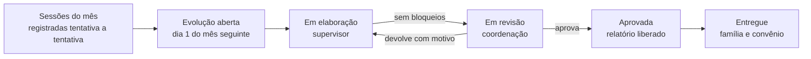

# 01 · Domínio da evolução mensal ABA

Este documento descreve o que o protótipo [`prototipo/evolucao-aba.html`](../../prototipo/evolucao-aba.html) simula: quem usa, o caminho da evolução no mês, as regras numeradas (E01 a E15) e as perguntas que o cliente precisa responder antes do sistema (P1 a P12). As regras são as que o protótipo aplica hoje; as perguntas marcam onde elas foram supostas.

> Estado em 04/11/2026: protótipo em validação com o cliente, sem código de sistema. Todos os nomes e números são fictícios.

## 1. Glossário

| Termo | O que é |
|---|---|
| **ABA** | Análise do Comportamento Aplicada. A intervenção ensina habilidades por programas estruturados e reduz comportamentos que atrapalham. |
| **PEI** | Plano de Ensino Individualizado da criança: a lista de programas ativos, com o alvo atual de cada um. Tem versões. |
| **Domínio** | Área do programa: Mando, Tato, Ouvinte, Imitação, Social, Brincar, Autocuidado, Pré-acadêmico, Tolerância. |
| **Programa** | O que se ensina (ex.: "Nomear figuras de animais"), com uma sequência de **alvos** (ex.: "Conjunto 1", "Conjunto 2"). |
| **Tentativa** | Uma oportunidade de resposta dentro da sessão. Cada programa tem um número de tentativas por sessão (10 no padrão). |
| **Nível de resposta** | Como a criança respondeu: independente (I), dica verbal (DV), dica gestual (DG), modelo (M), ajuda física (AF) ou erro / sem resposta. |
| **Independência** | Percentual de tentativas independentes. É o número central da evolução. |
| **Critério de aquisição** | Quando o alvo conta como aprendido: 80% de independência em 3 sessões seguidas (E03). |
| **Manutenção** | Alvo já adquirido que segue em sondagem para ver se a criança mantém. |
| **Comportamento-alvo de redução** | Comportamento que o PEI quer reduzir (birra, fuga de demanda, morder a mão…), com definição operacional. Medido em ocorrências por hora. |
| **VB-MAPP** | Avaliação de marcos de linguagem e aprendizagem, refeita a cada 6 meses. Orienta a revisão do PEI. |
| **Competência** | O mês a que a evolução se refere (ex.: out/2026). |
| **Evolução mensal** | O fechamento do mês de cada criança: números calculados, análise do supervisor, orientações à família e plano do mês seguinte. Vira o **relatório** entregue à família e ao convênio. |

## 2. Quem usa

| Perfil | O que faz no sistema |
|---|---|
| **Aplicador(a)** | Aplica as sessões e registra cada tentativa no celular ou tablet, durante a sessão. Vê a agenda do dia e as sessões que ficaram sem registro. |
| **Supervisor(a)** | Tem uma carteira de crianças. No começo do mês fecha a evolução do mês anterior de cada uma: resolve as pendências, escreve a análise e as orientações, define o plano e envia para a revisão. |
| **Coordenação** | Acompanha o painel das 5 unidades, revisa as evoluções e aprova ou devolve com o motivo. Registra a entrega à família e ao convênio. |
| Família e convênio | Recebem o relatório aprovado. Não usam o sistema no protótipo (P6). |

O protótipo troca de perfil pelo botão ao lado do nome, no rodapé do menu, para mostrar o mesmo dado visto por cada um.

## 3. O caminho da evolução

1. **Sessões.** O aplicador registra as tentativas de cada programa e as ocorrências de cada comportamento. Os números da evolução saem só daí (E01).
2. **Abertura.** No dia 1 o sistema abre a evolução do mês anterior de cada criança, já com frequência, independência, alvos adquiridos e alertas calculados.
3. **Elaboração.** O supervisor vê, ao lado, o que **bloqueia** o envio (laranja), o que é **alerta** (amarelo) e as **conquistas** (verde). Escreve a análise e as orientações e define o plano do mês seguinte, programa a programa.
4. **Revisão.** A coordenação confere o relatório e aprova ou devolve. A devolução vira um bloqueio na evolução, com o texto do motivo, e a versão sobe.
5. **Entrega.** O relatório aprovado sai com as assinaturas e a coordenação marca a entrega à família e ao convênio. Prazo: dia 10 do mês seguinte (E11).

## 4. Regras

| # | Regra | Onde aparece no protótipo |
|---|---|---|
| **E01** | Nenhum número da evolução é digitado. Frequência, independência, alvos adquiridos e comportamentos saem dos registros das sessões. O supervisor escreve só a interpretação. | Editor da evolução, relatório |
| **E02** | Independência do mês = tentativas independentes ÷ tentativas do mês. Não é a média das sessões, que daria o mesmo peso a uma sessão com 3 tentativas e a outra com 10. | Tabela de programas, modal do programa |
| **E03** | Alvo adquirido = 80% ou mais de independência em 3 sessões seguidas. A data de aquisição é a da terceira sessão. Depois disso o programa passa para manutenção e o plano sugere avançar para o próximo alvo. | Situação "Adquirido em dd/mm", conquistas do mês, plano |
| **E04** | Sem progresso: programa em treino que variou 5 p.p. ou menos por 2 meses ou mais. Gera alerta. | Alertas, situação do programa |
| **E05** | Regressão: queda de 5 p.p. ou mais em relação ao maior dos 2 meses anteriores. Programa em manutenção abaixo de 75% também gera alerta. | Alertas, situação do programa |
| **E06** | Comportamento-alvo é medido em ocorrências por hora de sessão registrada, para comparar meses com números diferentes de sessões. Alerta quando sobe 25% ou mais e pelo menos 0,3 por hora em relação ao mês anterior. | Tabela de comportamentos, alertas |
| **E07** | Sessão realizada (frequência assinada) sem registro de dados **bloqueia** o envio. Resolve-se com o registro atrasado, feito pelo aplicador e marcado como atrasado, ou marcando a sessão como "sem aplicação", com motivo. | Bloqueio, calendário, tela Hoje do aplicador |
| **E08** | Programa ativo no PEI sem nenhuma sessão no mês **bloqueia** o envio. Resolve-se com justificativa, que sai no relatório, ou suspendendo o programa no plano do mês seguinte. | Bloqueio, plano |
| **E09** | A análise do supervisor é obrigatória, com no mínimo 120 caracteres. Um botão insere o resumo dos números como ponto de partida. As orientações à família são recomendadas: a falta delas é alerta, não bloqueio. | Análise e orientações |
| **E10** | Fluxo: elaboração → revisão → aprovada → entregue. Enviada, a evolução fica só para leitura. A devolução exige motivo, volta como bloqueio e sobe a versão. Todo passo fica no histórico, com quem e quando. | Etapas, histórico, barra inferior |
| **E11** | A evolução do mês é entregue até o dia 10 do mês seguinte. O painel mostra quantas faltam e, nos meses fechados, quantas saíram no prazo. | Painel, menu |
| **E12** | Frequência = sessões realizadas ÷ agendadas, sem os feriados. Sessão "sem aplicação" conta como realizada. Abaixo de 75% gera alerta (é o ponto em que convênio e jurídico costumam pedir justificativa). A meta do painel é 85%. | Calendário, painel |
| **E13** | Reavaliação VB-MAPP semestral: alerta a partir de 30 dias antes do vencimento, com atalho para agendar. | Alertas, cadastro do assistido |
| **E14** | Registro × corrigido: o registro original da sessão nunca é apagado. A correção guarda o valor lido, o valor conferido, quem corrigiu, quando e por quê, e os dois aparecem juntos. | Modal do programa (sessão de 13/10 do Theo) |
| **E15** | Código da evolução: `UNI-AAMM-NNN-EV` (sigla da unidade, ano e mês da competência, sequência da criança na unidade). Ex.: `BOV-2610-006-EV`. | Lista, editor, relatório |

## 5. O que o cliente precisa responder

| # | Pergunta | O que o protótipo supôs |
|---|---|---|
| **P1** | O critério de aquisição é o mesmo para todos os programas, ou varia (ex.: 90% em 2 sessões, 100% em encadeamento)? | 80% em 3 sessões seguidas para todos |
| **P2** | O número de tentativas por sessão é fixo por programa? No encadeamento (lavar as mãos), cada passo conta como uma tentativa? | 10 por programa; 5 ou 6 em alguns |
| **P3** | Quais níveis de dica a equipe usa e em que ordem? Separam ajuda física parcial e total? Bate com a folha de registro atual? | I, DV, DG, M, AF, erro |
| **P4** | O aplicador registra tentativa a tentativa no celular durante a sessão, ou anota no papel e passa depois? Tem internet na sala? | Registro na hora, com foto da folha como alternativa |
| **P5** | Quem mantém a biblioteca de programas e o PEI de cada criança (criar programa, mudar alvo, nova versão)? | Em aberto; o plano do mês seguinte só registra a decisão |
| **P6** | Qual é o modelo de relatório que vai hoje para a família e para cada convênio (SASSEPE, Unimed, GEAP, FUSEX)? Quais seções e assinaturas são obrigatórias? A família acessa o sistema ou recebe PDF? | Relatório único, com supervisor (CRP) e coordenação, impresso ou PDF |
| **P7** | O prazo é dia 10 do mês seguinte para todos? Algum convênio pede antes? | Dia 10 para todos |
| **P8** | Os limiares de alerta estão bons: sem progresso (≤ 5 p.p. por 2 meses), regressão (−5 p.p.), comportamento (+25%), frequência (< 75%)? | Esses valores |
| **P9** | A reavaliação é sempre VB-MAPP semestral? Usam também ABLLS-R, Vineland ou outra? O resultado entra na evolução? | VB-MAPP a cada 6 meses, só como alerta |
| **P10** | Para os comportamentos, a contagem basta, ou precisam de duração, intensidade ou registro ABC (antecedente, comportamento, consequência)? | Só contagem |
| **P11** | A sessão realizada vem da ficha de frequência assinada, a mesma do faturamento (contas médicas)? O cadastro de crianças, unidades e convênios é um só? | Mesma origem, a integrar |
| **P12** | Quem aprova: uma coordenação geral ou uma por unidade? O supervisor pode aprovar a própria evolução? A família assina a ciência? | Uma coordenação; supervisor não aprova |

## 6. Telas do protótipo

| Rota | Tela | Perfil |
|---|---|---|
| `#/` | Painel (supervisão e coordenação) ou Hoje (aplicador) | todos |
| `#/evolucoes`, `#/evolucoes/<situação>` | Lista de evoluções do mês, por situação | supervisão, coordenação |
| `#/evolucoes/<id>` | Editor da evolução: resumo, programas, comportamentos, calendário, análise, plano e pendências | supervisão, coordenação |
| `#/relatorio/<id>[/<mês>]` | Relatório (prévia ou final), com os meses anteriores | todos |
| `#/sessoes`, `#/sessoes/<filtro>` | Sessões do mês (sem registro, registradas, faltas) | todos |
| `#/sessao/<id>[/<sessão>]` | Registro da sessão: ao vivo (hoje) ou atrasado (sessão do mês) | aplicador, supervisão |
| `#/assistidos`, `#/assistidos/<id>[/aba]` | Cadastro: PEI, evoluções e sessões de cada criança | todos |
| `#/programas` | Biblioteca de programas e alvos | supervisão, coordenação |

Os dados vivem só na memória da aba: recarregar a página volta tudo ao estado inicial. O gerador é determinístico, então os números são sempre os mesmos.
