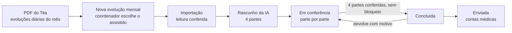

# 01 · Domínio da evolução mensal ABA

Este documento descreve o que o protótipo [`prototipo/evolucao-aba.html`](../../prototipo/evolucao-aba.html) simula: quem usa, o caminho da evolução no mês, as regras numeradas (E01 a E17) e as perguntas que o cliente precisa responder antes do sistema (P1 a P14). As regras são as que o protótipo aplica hoje; as perguntas marcam onde elas foram supostas.

> Estado em 04/11/2026: protótipo em validação com o cliente, sem código de sistema. Todos os nomes e números são fictícios.

A base desta versão são três documentos do cliente, que ficam fora do repositório porque têm dados reais: o PDF de evoluções diárias exportado do Tita, o manual "Evolução Mensal com Apoio de IA" e o modelo de evolução mensal de uma coordenadora. A primeira versão do protótipo, que supunha o registro de cada tentativa no celular, foi descartada: as evoluções diárias do Tita não trazem números, só texto.

## 1. Glossário

| Termo | O que é |
|---|---|
| **ABA** | Análise do Comportamento Aplicada. A intervenção ensina habilidades por programas estruturados e reduz comportamentos que atrapalham. |
| **Assistido** | A criança ou o adolescente atendido. Tem nome completo, gênero, plano de saúde e uma unidade. |
| **Coordenador(a) de unidade** | Psicólogo(a) responsável pela ABA de uma unidade num turno. Tem uma **carteira** de assistidos, é o autor técnico da evolução mensal e a assina com o CRP. |
| **Tita** | Sistema em que a equipe registra a evolução diária de cada sessão. Não é integrado: a ligação é o PDF exportado. |
| **Relatório de Evoluções Diárias** | PDF que o Tita exporta por assistido e por período. Traz o bloco **Dados do Favorecido** e, para cada evolução diária, os campos do SOAP. |
| **Análise do Atendimento** | O texto livre de cada evolução diária. É a única parte da evolução diária que o sistema lê. |
| **Evolução mensal** | O resumo técnico do mês de um assistido, no formato do modelo: identificação, texto da evolução, metas alcançadas e metas para o mês atual. Vai para contas médicas até o dia 10. |
| **Rascunho** | A evolução mensal escrita pela IA a partir das análises do mês. O coordenador confere, corrige e conclui. |
| **Parte** | Cada um dos 4 blocos do rascunho, conferidos um a um: Identificação, Evolução mensal, Metas alcançadas, Metas para o mês atual. |
| **Trecho** | Cada um dos 5 pedaços do texto da evolução, na ordem do manual: abertura, programas trabalhados, comportamentos e manejo, recursos e reforçadores, fechamento. |
| **Metas para o mês atual** | As metas em desenvolvimento do mês seguinte (o plano terapêutico, PT). As de setembro são o ponto de partida de outubro. |
| **Manutenção** | Meta alcançada que se repete do mês anterior. Leva "(manutenção)" ao lado e não pode ficar assim muitos meses seguidos. |
| **Lacuna** | Algo que a IA não achou nas análises (ex.: um programa do PT que nenhuma evolução diária cita). O rascunho mostra a lacuna em vez de inventar o texto. |
| **Conferência** | Checagem automática de uma regra. **Bloqueio** (laranja) impede concluir; **alerta** (amarelo) não impede. |
| **Arquivo do mês** | O Word do coordenador com todos os assistidos dele: cabeçalho uma vez, um bloco por assistido e a assinatura no fim. É o formato do modelo do cliente. |
| **Competência** | O mês a que a evolução se refere (ex.: out/2026). |
| **Contas médicas** | O setor de faturamento. Recebe as evoluções enviadas para anexar à cobrança de cada plano de saúde. |
| **Evolução de supervisão** | Outro relatório técnico, tirado do documento de evolução de supervisão do coordenador. **Fica para uma fase posterior** e não está no protótipo. |

## 2. Quem usa

| Perfil | O que faz no sistema |
|---|---|
| **Coordenador(a) de unidade** | Na tabela de evoluções do mês, inclui a evolução de cada assistido da carteira: escolhe o assistido, importa o PDF do Tita, confere o rascunho da IA parte por parte, conclui e envia a contas médicas. Mantém a própria assinatura. |
| **Coordenação geral ABA** | Acompanha as unidades e os coordenadores no painel, abre qualquer evolução e pode devolver uma evolução concluída, antes do envio, com o motivo (P2). Mantém a lista de termos inadequados (P12). |
| **Contas médicas** | Recebe as evoluções enviadas, filtra por plano e unidade e baixa o Word. Vê quem ainda não enviou. |
| Aplicadores | Registram as sessões no Tita. Não usam este sistema. |

O protótipo troca de perfil pelo botão ao lado do nome, no rodapé do menu, para mostrar o mesmo dado visto por cada um.

## 3. O caminho da evolução

1. **Nova evolução mensal.** Na tabela de evoluções do mês, o coordenador clica em "Nova evolução mensal" e escolhe um assistido da carteira que ainda não tem evolução no mês (E01).
2. **Importação.** O sistema pede o PDF de evoluções diárias daquele assistido, exportado do Tita. Lê só os Dados do Favorecido e as análises do atendimento (E02) e confere se o arquivo é o certo (E03).
3. **Rascunho.** A IA lê as análises, a evolução do mês anterior e as metas para o mês atual de setembro, e devolve o rascunho em 4 partes, cada frase e cada meta ligadas às evoluções diárias de onde saíram (E06). Nome e plano não vão para a IA (E05).
4. **Conferência.** O coordenador confere cada parte: vê a fonte, edita, gera a parte de novo com uma instrução ou marca como conferida (E08). As conferências automáticas mostram o que bloqueia e o que é alerta (E09 a E12). O texto da IA nunca se perde (E07).
5. **Conclusão e envio.** Com as 4 partes conferidas e sem bloqueio, a evolução fica concluída e entra no arquivo do mês. O coordenador envia a contas médicas, com a assinatura cadastrada (E14). Prazo: dia 10 (E15).

## 4. Regras

| # | Regra | Onde aparece no protótipo |
|---|---|---|
| **E01** | Uma evolução por assistido por competência, só de assistidos da carteira do coordenador. Na escolha do assistido, quem já tem evolução no mês aparece marcado e não pode ser escolhido. | Nova evolução mensal |
| **E02** | Do PDF do Tita o sistema lê só o bloco **Dados do Favorecido** (nome, idade, gênero, terapias, profissionais, período avaliado, filtros aplicados, total de evoluções diárias) e, de cada evolução diária, a **data** e o texto da **Análise do Atendimento**. O resto do arquivo (sentimentos, comportamento, objetivo, planejamento) é descartado. Cabeçalho e rodapé de página que caem no meio de uma análise são removidos. | Importação |
| **E03** | A importação **bloqueia** quando o favorecido não é o assistido escolhido, quando o período avaliado não é o da competência, quando a terapia não é ABA ou quando o filtro de profissional não é "Todos". **Alerta** quando o número de análises lidas é diferente do total de evoluções diárias informado no PDF. | Importação |
| **E04** | Evolução diária cuja análise registra que o assistido não veio conta como **falta**, não como sessão. Frequência = sessões ÷ evoluções diárias do mês. Abaixo de 75%, a abertura do texto cita a frequência (P5). | Importação, rascunho |
| **E05** | Nome, plano e CRP não vão para a IA. Antes do envio, o nome do assistido (completo e primeiro nome) é trocado por "o assistido" ou "a assistida", pelo gênero do PDF. O sistema põe o nome de volta só na emissão. | Importação ("nome trocado em N trechos") |
| **E06** | O rascunho vem em 4 partes. **Identificação** vem do cadastro, não da IA. **Evolução mensal** vem nos 5 trechos do manual. **Metas alcançadas** e **metas para o mês atual** vêm em lista. Cada frase e cada meta indicam as evoluções diárias (datas) de onde saíram. O que a IA não acha nas análises vira **lacuna**, nunca texto inventado. | Conferência da evolução |
| **E07** | Texto da IA × texto revisado: o texto gerado nunca é apagado. Cada edição e cada "gerar de novo" cria uma versão da parte, com quem, quando e, no caso da IA, a instrução usada. As duas versões podem ser vistas lado a lado. | "Comparar com o texto da IA", histórico |
| **E08** | Cada parte é marcada como conferida pelo coordenador. Editar ou gerar de novo uma parte conferida a devolve para "a conferir". A evolução só conclui com as 4 partes conferidas e sem bloqueio. | Partes, barra inferior |
| **E09** | **Identificação:** nome completo (com sobrenome), plano de saúde e especialidade preenchidos, senão **bloqueia**. Corrige-se no cadastro. | Parte 1 |
| **E10** | **Evolução mensal:** texto com menos de 7 linhas **bloqueia** (1 linha = 95 caracteres, Cambria 12 em A4). Lacuna não resolvida **bloqueia**. Texto 60% ou mais parecido com o do mês anterior é **alerta** (P7). Termo da lista de inadequados é **alerta**, com a troca pelo termo técnico em um toque (P12). | Parte 2 |
| **E11** | **Metas alcançadas:** meta igual a uma meta alcançada no mês anterior leva "(manutenção)". Se ela já estava em manutenção no mês anterior, é **alerta** (P6). Menos de 4 metas alcançadas é **alerta**, não bloqueio: o mês pode ter tido menos conquistas, e o sistema não pede para inventar. | Parte 3 |
| **E12** | **Metas para o mês atual:** começam pela frase padrão, que não se edita. Menos de 4 metas **bloqueia**. Meta que já foi alcançada (neste mês ou em manutenção) **bloqueia**. Meta ligada a um programa que o texto não cita é **alerta**. | Parte 4 |
| **E13** | Fluxo: em conferência → concluída → enviada. A coordenação geral pode devolver uma evolução concluída, antes do envio, com o motivo; a devolução vira bloqueio até o coordenador marcar como resolvida. Enviada fica só para leitura. Todo passo fica no histórico. | Situação, histórico, barra inferior |
| **E14** | Emissão em Word no formato do modelo: Cambria 12, espaçamento 1,5. O **arquivo do mês** tem o cabeçalho uma vez (profissional, unidade, turno, especialidade, mês/ano), um bloco por evolução concluída ou enviada e a assinatura no fim; também dá para baixar a evolução de um assistido só. Sem assinatura ou carimbo cadastrado, o envio **bloqueia**. | Documento, arquivo do mês, assinatura |
| **E15** | A evolução do mês vai para contas médicas até o dia 10 do mês seguinte. A tabela e o painel mostram quantas faltam. | Tabela, painel, menu |
| **E16** | Código da evolução: `UNI-AAMM-NNN-EV` (sigla da unidade, ano e mês da competência, sequência do assistido na unidade). Ex.: `BOV-2610-001-EV`. | Tabela, conferência, documento |
| **E17** | Turno integral: um arquivo do mês só para manhã e tarde (P8). | Arquivo do mês (não simulado) |

## 5. O que o cliente precisa responder

| # | Pergunta | O que o protótipo supôs |
|---|---|---|
| **P1** | Contas médicas recebe o arquivo do coordenador com todos os assistidos (como o modelo) ou um arquivo por assistido? | Os dois: o arquivo do mês e o individual |
| **P2** | Há uma revisão entre o coordenador e contas médicas? O manual diz que "a coordenação" devolve as evoluções repetidas. | A coordenação geral pode devolver uma concluída antes do envio; não é etapa obrigatória |
| **P3** | O PT (metas em desenvolvimento) está no Tita, num Word ou deve ficar no sistema? As "metas em desenvolvimento" da evolução de supervisão são as mesmas? | No sistema: as metas para o mês atual de cada evolução são o PT do mês seguinte |
| **P4** | No primeiro mês, importamos a evolução feita à mão no mês anterior, para comparar e controlar a manutenção? | Sim; no protótipo, setembro e agosto já estão no sistema |
| **P5** | A frequência vem do Tita ou da agenda? A partir de que percentual entra no texto? | Do Tita; abaixo de 75% |
| **P6** | Quantos meses seguidos uma meta pode ficar em manutenção? Qual o mínimo de metas alcançadas? | Alerta no segundo mês seguido; mínimo de 4, como alerta |
| **P7** | A semelhança com o mês anterior bloqueia ou só alerta? Qual o limite? | Alerta a partir de 60% |
| **P8** | O que é o "PM" de "turno integral: um arquivo só, exceto PM"? Cada coordenador corresponde a uma unidade e um turno? | Um coordenador por unidade e turno; PM em aberto |
| **P9** | O Tita exporta em Excel ou tem API? A equipe passaria a preencher "Habilidades trabalhadas" e "Alcance", que hoje vêm vazios? | PDF por assistido, como no exemplo |
| **P10** | A IA é a API da OpenAI contratada pela clínica, com garantia de que os dados não treinam modelos? Qual modelo? | API contratada, chamada só pelo servidor |
| **P11** | Contas médicas só baixa o Word, ou o sistema integra com o de contas médicas (cadastro de assistidos, planos e unidades em comum)? | Só baixa; cadastro a integrar |
| **P12** | Quem mantém a lista de termos inadequados e os substitutos técnicos? | A coordenação geral; o protótipo traz uma lista inicial |
| **P13** | "Por parte" são as 4 partes, ou cada trecho do texto é conferido separadamente? | As 4 partes |
| **P14** | A assinatura é uma imagem (assinatura ou carimbo) ou precisa de certificado digital (ICP-Brasil)? | Imagem cadastrada pelo coordenador |

## 6. Telas do protótipo

| Rota | Tela | Perfil |
|---|---|---|
| `#/` | Evoluções do mês (coordenador), painel das unidades (coordenação geral) ou evoluções recebidas (contas médicas) | todos |
| `#/evolucoes`, `#/evolucoes/<situação>` | Tabela de evoluções do mês, com cards que filtram por situação | coordenador, coordenação geral |
| `#/nova/<assistido>` | Importação do PDF do Tita e geração do rascunho | coordenador |
| `#/evolucao/<id>` | Conferência por parte: rascunho, fonte do Tita, conferências, mês anterior e histórico | coordenador, coordenação geral |
| `#/documento/<id>` | A evolução de um assistido no formato do Word | todos (contas médicas vê só as enviadas) |
| `#/arquivo/<coordenador>`, `#/arquivo/<coordenador>/<competência>` | O arquivo do mês do coordenador | todos (contas médicas vê só as enviadas) |
| `#/recebidas` | Evoluções enviadas a contas médicas, por assistido ou por coordenador, com filtro de plano e unidade | contas médicas, coordenação geral |
| `#/termos` | Lista de termos inadequados e substitutos | coordenação geral (edita), coordenador (lê) |
| `#/assinatura` | Assinatura ou carimbo do coordenador, por arquivo ou câmera | coordenador |

Os dados vivem só na memória da aba: recarregar a página volta tudo ao estado inicial. O gerador é determinístico, então os números são sempre os mesmos. A IA é simulada: o rascunho sai de textos e modelos fictícios do próprio arquivo, e o PDF escolhido pelo usuário não é lido.
