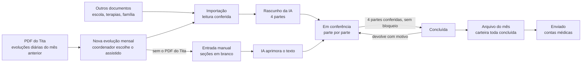

# 01 · Domínio da evolução mensal ABA

Este documento descreve o que o protótipo [`prototipo/evolucao-aba.html`](../../prototipo/evolucao-aba.html) simula: quem usa, o caminho da evolução no mês, as regras numeradas (E01 a E28) e as perguntas que o cliente precisa responder antes do sistema (P1 a P23). As regras são as que o protótipo aplica hoje; as perguntas marcam onde elas foram supostas.

> Estado em 04/11/2026: protótipo em validação com o cliente, sem código de sistema. Todos os nomes e números são fictícios.

A base desta versão são três documentos do cliente, que ficam fora do repositório porque têm dados reais: o PDF de evoluções diárias exportado do Tita, o manual "Evolução Mensal com Apoio de IA" e o modelo de evolução mensal de uma coordenadora. A primeira versão do protótipo, que supunha o registro de cada tentativa no celular, foi descartada: as evoluções diárias do Tita não trazem números, só texto.

## 1. Glossário

| Termo | O que é |
|---|---|
| **ABA** | Análise do Comportamento Aplicada. A intervenção ensina habilidades por programas estruturados e reduz comportamentos que atrapalham. |
| **Assistido** | A criança ou o adolescente atendido. Tem nome completo, gênero, plano de saúde e uma unidade. |
| **Coordenador(a) de unidade** | Psicólogo(a) responsável pela ABA de uma unidade num turno. Tem uma **carteira** de assistidos, é o autor técnico da evolução mensal e a assina com o CRP. |
| **Tita** | Sistema em que a equipe registra a evolução diária de cada sessão. Não é integrado: a ligação é o PDF exportado. |
| **Relatório de Evoluções Diárias** | PDF que o Tita exporta por assistido e por período. Traz o bloco **Dados do Favorecido** e, para cada evolução diária, os campos do SOAP. |
| **Análise do Atendimento** | O texto livre de cada evolução diária. É a única parte da evolução diária que o sistema lê. |
| **Outros documentos** | Arquivos que o coordenador junta na nova evolução, além do PDF do Tita: relatório da escola, de outra terapia, registro da família, avaliação, PEI. A IA lê todos junto com as análises (E25). |
| **Entrada manual** | O caminho sem o PDF do Tita: o sistema abre as seções da evolução em branco, o coordenador descreve o mês e, no fim, a IA aprimora o texto (E26). |
| **Evolução mensal** | O resumo técnico de um mês de atendimento de um assistido, no formato do modelo: identificação, texto da evolução, metas alcançadas e metas para o mês atual. É feita no começo de um mês com as evoluções diárias do mês anterior (E18) e vai para contas médicas dentro do arquivo do mês, até o dia 10. |
| **Rascunho** | A evolução mensal escrita pela IA a partir das análises do período analisado e dos outros documentos, ou aprimorada pela IA a partir do texto do coordenador (E26). O coordenador confere, corrige e conclui. |
| **Parte** | Cada um dos 4 blocos do rascunho, conferidos um a um: Identificação, Evolução mensal, Metas alcançadas, Metas para o mês atual. |
| **Trecho** | Cada um dos 5 pedaços do texto da evolução, na ordem do manual: abertura, programas trabalhados, comportamentos e manejo, recursos e reforçadores, fechamento. |
| **Cadastro de metas** | O plano terapêutico (PT) de cada assistido: cada meta com programa, texto, critério de alcance e situação (em desenvolvimento, alcançada, em manutenção, suspensa), com histórico (E23). |
| **Metas para o mês atual** | As metas em desenvolvimento do mês em que a evolução é feita, que partem do cadastro de metas. A evolução de outubro trouxe as metas para outubro; a de novembro confere o que as sessões de outubro fizeram com elas e traz as metas para novembro. |
| **Nível de apoio** | Quanto apoio o assistido precisou no programa, lido pela IA no texto da análise, em 5 degraus: ajuda física total, ajuda física parcial, dica gestual ou modelo, dica verbal, independente. É a medida da evolução das metas em gráfico (E27). |
| **Manutenção** | Meta alcançada que se repete da evolução anterior. Leva "(manutenção)" ao lado e não pode ficar assim muitos meses seguidos. |
| **Lacuna** | Algo que a IA não achou nas análises (ex.: um programa do PT que nenhuma evolução diária cita). O rascunho mostra a lacuna em vez de inventar o texto, e o coordenador a resolve (E10). |
| **Dica para a IA** | Instrução de correção que o coordenador deixa no botão "i" de um bloco do rascunho. Vai para a tabela dica-ia e passa por curadoria (E21). |
| **Orientação da IA** | Dica aprovada na curadoria. Fica na tabela orientacao-ia, e a IA lê as orientações ativas antes de cada análise (E22). |
| **Conferência** | Checagem automática de uma regra. **Bloqueio** (laranja) impede concluir; **alerta** (amarelo) não impede. |
| **Arquivo do mês** | O Word de uma carteira (unidade e turno) com todos os assistidos dela: cabeçalho uma vez, um bloco por assistido e a assinatura do coordenador no fim. É o formato do modelo do cliente e é **o que vai para contas médicas**: um arquivo por carteira e mês, nunca a evolução de um assistido sozinha (E24). Quem coordena duas carteiras envia dois arquivos. |
| **Mês da evolução** | O mês em que a evolução é feita e enviada, que dá nome a ela, ao arquivo do mês e ao código (ex.: evolução de novembro de 2026, nov/2026). |
| **Período analisado** | Do dia 1º ao último dia do mês anterior ao mês da evolução. A evolução de novembro analisa 01/10 a 31/10 (E18). |
| **Dia analisado** | Dia com evolução diária que entrou numa evolução mensal. Fica registrado no banco com a evolução a que pertence; um dia só entra numa evolução (E20). |
| **Contas médicas** | O setor de faturamento. Recebe o arquivo do mês de cada coordenador e anexa a evolução de cada assistido à cobrança do plano de saúde. |
| **Evolução de supervisão** | Outro relatório técnico, tirado do documento de evolução de supervisão do coordenador. **Fica para uma fase posterior** e não está no protótipo. |

## 2. Quem usa

| Perfil | O que faz no sistema |
|---|---|
| **Coordenador(a) de unidade** | Na tabela de evoluções do mês, inclui a evolução de cada assistido da carteira: escolhe o assistido, importa o PDF do Tita e outros documentos (ou escreve à mão), confere o rascunho da IA parte por parte e conclui. Com a carteira toda concluída, envia o arquivo do mês a contas médicas. Deixa dicas para a IA nos blocos do rascunho. Mantém a própria assinatura e o cadastro de metas da carteira. |
| **Coordenação geral ABA** | Acompanha as unidades e os coordenadores no painel, abre qualquer evolução e pode devolver uma evolução concluída, antes do envio do arquivo do mês, com o motivo (P2). Mantém a lista de termos inadequados (P12) e faz a curadoria das dicas para a IA em Configurações (P17). Lê o cadastro de metas de todos os assistidos. |
| **Contas médicas** | Recebe o arquivo do mês de cada coordenador e baixa o Word. Acha a evolução de cada assistido por plano, unidade, nome ou código. Vê quais arquivos ainda não chegaram. |
| Aplicadores | Registram as sessões no Tita. Não usam este sistema. |

O protótipo troca de perfil pelo botão ao lado do nome, no rodapé do menu, para mostrar o mesmo dado visto por cada um.

## 3. O caminho da evolução

1. **Nova evolução mensal.** Na tabela de evoluções do mês, o coordenador clica em "Nova evolução mensal" e escolhe um assistido da carteira que ainda não tem evolução no mês (E01).
2. **Importação.** O sistema pede o PDF de evoluções diárias daquele assistido, exportado do Tita com o período analisado: na evolução de novembro, 01/10 a 31/10 (E18). Lê só os Dados do Favorecido e as análises do atendimento (E02), confere se o arquivo é o certo (E03) e avisa as datas divergentes (E19). Os dias que entram na evolução ficam registrados no banco (E20). Junto com o PDF, o coordenador pode juntar outros documentos, que também entram na análise (E25). Sem o PDF, ele pode escrever à mão: o sistema abre as seções em branco e, no fim, a IA aprimora o texto (E26).
3. **Rascunho.** A IA lê primeiro as orientações aprovadas (E22) e depois as análises do período analisado, os outros documentos (E25), a evolução anterior e as metas em desenvolvimento do cadastro de metas (E23), e devolve o rascunho em 4 partes, cada frase e cada meta ligadas às evoluções diárias e aos documentos de onde saíram (E06). Nome e plano não vão para a IA (E05).
4. **Conferência.** O coordenador confere cada parte: vê a fonte, edita, gera a parte de novo com uma instrução ou marca como conferida (E08). As conferências automáticas mostram o que bloqueia e o que é alerta (E09 a E12). O texto da IA nunca se perde (E07).
5. **Conclusão e envio do arquivo.** Com as 4 partes conferidas e sem bloqueio, a evolução fica concluída e entra no arquivo do mês. Com a carteira toda concluída, o coordenador envia **o arquivo do mês** a contas médicas, com a assinatura cadastrada (E14, E24): a evolução de um assistido não vai sozinha. Prazo: dia 10 (E15). O envio atualiza o cadastro de metas de cada assistido (E23).

## 4. Regras

| # | Regra | Onde aparece no protótipo |
|---|---|---|
| **E01** | Uma evolução por assistido por mês da evolução, só de assistidos da carteira do coordenador. Na escolha do assistido, quem já tem evolução no mês aparece marcado e não pode ser escolhido. | Nova evolução mensal |
| **E02** | Do PDF do Tita o sistema lê só o bloco **Dados do Favorecido** (nome, idade, gênero, terapias, profissionais, período avaliado, filtros aplicados, total de evoluções diárias) e, de cada evolução diária, a **data** e o texto da **Análise do Atendimento**. O resto do arquivo (sentimentos, comportamento, objetivo, planejamento) é descartado. Cabeçalho e rodapé de página que caem no meio de uma análise são removidos. | Importação |
| **E03** | A importação **bloqueia** quando o favorecido não é o assistido escolhido, quando o período avaliado do PDF não cobre o período analisado inteiro (E18), quando a terapia não é ABA ou quando o filtro de profissional não é "Todos". **Alerta** quando o período do PDF passa do período analisado (as datas de fora seguem a E19) e quando o número de análises lidas é diferente do total de evoluções diárias informado no PDF. | Importação |
| **E04** | Evolução diária cuja análise registra que o assistido não veio conta como **falta**, não como sessão. Frequência = sessões ÷ evoluções diárias do período analisado. Abaixo de 75%, a abertura do texto cita a frequência (P5). | Importação, rascunho |
| **E05** | Nome, plano e CRP não vão para a IA. Antes do envio, o nome do assistido (completo e primeiro nome) é trocado por "o assistido" ou "a assistida", pelo gênero do PDF. O sistema põe o nome de volta só na emissão. O mesmo vale para os outros documentos (E25) e para o texto escrito à mão (E26). | Importação ("nome trocado em N trechos"), outros documentos, entrada manual |
| **E06** | O rascunho vem em 4 partes. **Identificação** vem do cadastro, não da IA. **Evolução mensal** vem nos 5 trechos do manual. **Metas alcançadas** e **metas para o mês atual** vêm em lista. Cada frase e cada meta indicam as evoluções diárias (datas) e os outros documentos de onde saíram (E25). O que a IA não acha nas análises vira **lacuna**, nunca texto inventado. | Conferência da evolução |
| **E07** | Texto da IA × texto revisado: o texto gerado nunca é apagado. Cada edição e cada "gerar de novo" cria uma versão da parte, com quem, quando e, no caso da IA, a instrução usada. As duas versões podem ser vistas lado a lado. | "Comparar com o texto da IA", histórico |
| **E08** | Cada parte é marcada como conferida pelo coordenador. Editar ou gerar de novo uma parte conferida a devolve para "a conferir". A evolução só conclui com as 4 partes conferidas e sem bloqueio. | Partes, barra inferior |
| **E09** | **Identificação:** nome completo (com sobrenome), plano de saúde e especialidade preenchidos, senão **bloqueia**. Corrige-se no cadastro. | Parte 1 |
| **E10** | **Evolução mensal:** texto com menos de 7 linhas **bloqueia** (1 linha = 95 caracteres, Cambria 12 em A4). Lacuna não resolvida **bloqueia**. A lacuna se resolve de três jeitos: **não foi trabalhado no mês** (entra no texto a frase de que o programa não foi aplicado no período), **foi trabalhado** (o coordenador escreve, e a lacuna se resolve quando o texto cita o programa) ou **ignorar** (nada entra no texto; fica registrado quem ignorou e quando, e a meta do programa, se continuar nas metas para o mês atual, leva o alerta da E12). Texto 60% ou mais parecido com o do mês anterior é **alerta** (P7). Termo da lista de inadequados é **alerta**, com a troca pelo termo técnico em um toque (P12). | Parte 2 |
| **E11** | **Metas alcançadas:** meta igual a uma meta alcançada na evolução anterior leva "(manutenção)". Se ela já estava em manutenção na evolução anterior, é **alerta** (P6). Menos de 4 metas alcançadas é **alerta**, não bloqueio: o mês pode ter tido menos conquistas, e o sistema não pede para inventar. | Parte 3 |
| **E12** | **Metas para o mês atual:** começam pela frase padrão, que não se edita. Menos de 4 metas **bloqueia**. Meta que já foi alcançada (neste mês ou em manutenção) **bloqueia**. Meta ligada a um programa que o texto não cita é **alerta**. | Parte 4 |
| **E13** | Fluxo: em conferência → concluída → enviada. A evolução fica **enviada** quando o arquivo do mês em que ela está é enviado (E24); não existe envio de uma evolução sozinha. Enquanto o arquivo não foi enviado, o coordenador pode reabrir uma concluída, e a coordenação geral pode devolvê-la com o motivo; a devolução vira bloqueio até o coordenador marcar como resolvida. Enviada fica só para leitura. Todo passo fica no histórico. | Situação, histórico, barra inferior |
| **E14** | Emissão em Word no formato do modelo: Cambria 12, espaçamento 1,5. O **arquivo do mês** tem o cabeçalho uma vez (profissional, unidade, turno, especialidade, mês/ano), um bloco por evolução, em ordem alfabética, e a assinatura no fim. A evolução de um assistido pode ser vista e baixada pelo coordenador e pela coordenação geral para conferência, mas não vai sozinha a contas médicas. Sem assinatura ou carimbo cadastrado, o envio do arquivo **bloqueia**. A assinatura é uma imagem que o coordenador envia, por arquivo ou foto (P14). Trocar não apaga a anterior: o arquivo já enviado fica com a assinatura da época. | Documento, arquivo do mês, assinatura |
| **E15** | O arquivo do mês vai para contas médicas até o dia 10 do mês da evolução: o de novembro, com as sessões de outubro, até 10/11. A tabela, o painel e o menu mostram quantas evoluções faltam concluir e quais arquivos ainda não chegaram. | Tabela, painel, menu, arquivos recebidos |
| **E16** | Código da evolução: `UNI-AAMM-NNN-EV` (sigla da unidade, ano e mês da evolução, sequência do assistido na unidade). Ex.: `BOV-2611-001-EV` é a evolução de novembro de 2026. | Tabela, conferência, documento |
| **E17** | Turno integral: a carteira de turno integral tem um arquivo do mês só, para manhã e tarde (P8). | Arquivo do mês (não simulado) |
| **E18** | **Período analisado:** a evolução é feita no mês corrente com as evoluções diárias do mês anterior inteiro, do dia 1º ao último dia. A evolução de novembro analisa 01/10 a 31/10. O período sai do mês da evolução e não se edita; aparece na importação, no cabeçalho da evolução, na tabela e na aba Tita. | Importação, conferência, tabela |
| **E19** | **Datas divergentes:** a leitura confere a data de cada evolução diária com o período analisado e o sistema **avisa** (alerta, não bloqueio). Evolução diária com data antes do período (se o dia já foi analisado, aparece a evolução em que entrou) ou depois dele (fica para a evolução seguinte) é listada com a data e o motivo, marcada no calendário e **não vai para a IA**. Análise cujo texto cita uma data diferente da data do registro (ex.: registro de 15/10 que diz "sessão realizada em 15/09") também é alerta: ela entra no rascunho, e o coordenador confere no Tita. Os avisos da importação seguem nas conferências da evolução até o coordenador dar ciência (P16). | Importação, conferências, aba Tita |
| **E20** | **Dias analisados no banco:** ao gerar o rascunho, cada dia do período com evolução diária fica registrado com o assistido, a evolução, o número de evoluções diárias e se foi falta. Um dia só pode pertencer a uma evolução mensal, e só a uma cujo período o contenha: o banco recusa o resto. Importar de novo troca os dias da mesma evolução. O calendário de dias analisados mostra sessões, faltas e datas fora do período. | Importação, aba Tita |
| **E21** | **Dica para a IA:** cada bloco que a IA escreve tem o botão **"i"**: os 5 trechos da evolução mensal (na leitura e na edição), as metas alcançadas e as metas para o mês atual. Ele abre no próprio bloco um campo para a instrução de correção daquele campo. A dica é salva na tabela **dica-ia** com data, hora, usuário, campo de origem, texto original (a última versão da IA daquele campo) e a dica, como **pendente**. O nome do assistido sai do texto original e da dica antes de salvar (E05). A dica não muda o texto da evolução: para corrigir agora, o coordenador edita ou gera de novo. | Partes 2, 3 e 4; histórico |
| **E22** | **Curadoria e orientações da IA:** em **Configurações**, a coordenação geral vê a tabela dica-ia, com cards que filtram por situação. A dica pode ser **aprovada**, com a redação ajustada se preciso, e vira uma orientação na tabela **orientacao-ia** (campo, texto, quem aprovou e quando, de qual dica veio); ou **descartada**, com motivo opcional, e fica só no registro. A IA lê as orientações ativas **antes de cada análise**: no rascunho e em "Gerar de novo". Uma orientação pode ser retirada e deixa de ser lida. | Configurações, geração do rascunho |
| **E23** | **Cadastro de metas por assistido:** cada assistido tem o seu plano terapêutico, com metas por programa, texto, critério de alcance e situação: em desenvolvimento, alcançada, em manutenção ou suspensa. Cada mudança fica no histórico da meta. As metas em desenvolvimento são o ponto de partida das **metas para o mês atual** do rascunho: o texto vem do cadastro, a meta nova entra e a suspensa sai. Ao **enviar o arquivo do mês**, as metas alcançadas de cada evolução saem de desenvolvimento (as que seguem em manutenção ficam assim marcadas) e as metas novas da parte 4 entram no cadastro. O coordenador edita o cadastro da carteira; a coordenação geral lê todos. | Metas dos assistidos, partes 3 e 4, envio |
| **E24** | **Envio do arquivo do mês:** o que vai para contas médicas é o **arquivo do mês** de cada carteira, não a evolução de cada assistido. O envio **bloqueia** enquanto algum assistido ativo da carteira estiver sem evolução ou com a evolução em conferência, e sem a assinatura cadastrada (E14). Assistido sem sessão no mês (férias, afastamento, alta) sai pelo cadastro: a coordenação geral o desativa ou o tira da carteira, e o arquivo leva só os ativos (P19). O arquivo é sempre o do mês aberto: virou o mês, o do mês anterior não se envia mais pelo sistema. Ao enviar, todas as evoluções do arquivo ficam enviadas na mesma data e hora, a carteira não abre outra evolução naquele mês (P19), e o cadastro de metas de cada assistido é atualizado (E23). O arquivo fica registrado com a carteira, o coordenador, o mês, quem enviou, quando e as evoluções que levou. Contas médicas vê só os arquivos enviados, por arquivo ou por assistido (com plano e código), e os arquivos que ainda não chegaram. | Arquivo do mês, tabela, painel, arquivos recebidos |
| **E25** | **Outros documentos na análise:** na nova evolução, além do PDF do Tita, o coordenador pode juntar outros documentos que entram na análise: relatório da escola, de outra terapia (fono, TO, psicopedagogia), registro da família, avaliação, PEI ou outro. Aceita PDF, Word e imagem, vários de uma vez, por arquivo ou pela câmera ("Tirar foto"). Cada documento mostra o tipo (editável), a data, as páginas e os trechos lidos, já sem o nome (E05). Documento em que o nome não é o do assistido **bloqueia** a geração até sair da lista e não vai para a IA. Documento com data fora do período analisado é **alerta**: a IA o usa como contexto, e o aviso segue nas conferências. A IA lê as análises do Tita e todos os documentos; a frase que usa um documento mostra qual, na aba Fontes, e "Gerar de novo" lê os mesmos documentos. Documento não conta como dia analisado (E20). | Nova evolução, aba Fontes, conferências |
| **E26** | **Entrada manual:** na nova evolução, o coordenador pode escrever à mão em vez de importar o PDF do Tita. O sistema abre em branco as 5 seções da evolução mensal (abertura, programas trabalhados, comportamentos e manejo, recursos e reforçadores, fechamento), as metas alcançadas e as metas para o mês atual (uma por linha, com as metas em desenvolvimento do cadastro a um toque). Seção em branco fica em branco. No fim, "Aprimorar com a IA": o nome sai do texto (E05), a IA lê as orientações aprovadas (E22) e melhora a linguagem (termo técnico, termos da lista, coesão, terceira pessoa) **sem acrescentar fato**; programa do cadastro de metas que o texto não cita vira lacuna (E10). O texto do coordenador fica guardado como a primeira versão de cada parte e o aprimorado como a segunda (E07), e a aba Fontes mostra o que foi escrito. A evolução segue para a conferência com todas as regras, sem dias analisados (E20) e com o alerta "Escrita à mão, sem o PDF do Tita". | Nova evolução, conferência, aba Fontes |
| **E27** | **Evolução das metas em gráfico:** na lista de evoluções, cada assistido tem o ícone de gráfico, que abre a evolução das metas dele. O Tita não traz número (o "Alcance" vem 0%), então a medida é o **nível de apoio** que a IA lê na Análise do Atendimento de cada sessão em que o programa da meta foi trabalhado, em 5 degraus: ajuda física total, ajuda física parcial, dica gestual ou modelo, dica verbal, independente. Quando o trecho cita mais de um nível, vale o de mais apoio, para a leitura nunca exagerar o avanço. Sessão em que o programa aparece sem o nível conta como trabalhada **sem nível** e não vira ponto na escada: nada é inventado (E06). Cada ponto mostra a data e o trecho de onde saiu. A tela tem: cards por situação da meta e "Pedem atenção", que filtram as metas; as metas que chegaram à independência, semana a semana, diante da mediana da carteira, em cinza; a escada de cada meta até a independência, com o alcance marcado; e o mapa de sessões por semana. Os destaques apontam a meta que chegou mais rápido à independência, a que está no mesmo degrau há 3 semanas ou mais e a que não aparece nas análises do último mês. Todo gráfico tem a versão em tabela. Só o coordenador (a carteira dele) e a coordenação geral veem; contas médicas não. | Lista de evoluções, evolução das metas |
| **E28** | **Relatório de metas em PDF e compartilhar:** na evolução das metas, "Baixar PDF" gera o relatório com tudo o que a tela mostra, sempre sem filtro: as metas independentes e a comparação com a mediana da carteira, o gráfico semana a semana, os destaques, a situação das metas, a escada de cada meta e as tabelas com os números. O texto do PDF é selecionável, e cada página diz quem emitiu, quando e que o documento tem dados de saúde de uma criança. O nome do arquivo leva o código do assistido, não o nome; dentro, o nome aparece, como na emissão do Word (E05). O ícone de compartilhar abre duas saídas: enviar o PDF pelo aparelho (WhatsApp, e-mail ou outro aplicativo; onde o navegador não envia arquivo, o PDF é baixado para anexar) ou copiar o link da tela, que só abre para quem já tem acesso ao assistido. Antes de enviar, o aviso lembra que o relatório tem dados de saúde. Cada download, envio e link copiado fica registrado com quem e quando, e o registro aparece na janela de compartilhar. O acesso é o da E27: coordenador (carteira dele) e coordenação geral. | Evolução das metas |

## 5. O que o cliente precisa responder

| # | Pergunta | O que o protótipo supôs |
|---|---|---|
| **P1** | ~~Contas médicas recebe o arquivo do coordenador com todos os assistidos ou um arquivo por assistido?~~ Respondida: recebe o arquivo do mês do coordenador, com todos os assistidos (E24). | A evolução individual fica só para conferência |
| **P2** | Há uma revisão entre o coordenador e contas médicas? O manual diz que "a coordenação" devolve as evoluções repetidas. | A coordenação geral pode devolver uma concluída antes do envio do arquivo; não é etapa obrigatória |
| **P3** | ~~O PT está no Tita, num Word ou deve ficar no sistema?~~ Respondida: fica no sistema, no cadastro de metas por assistido (E23). Falta saber: as "metas em desenvolvimento" da evolução de supervisão são as mesmas, e quem cadastra o PT inicial de um assistido novo? | O coordenador da carteira cadastra; as metas são as mesmas da supervisão |
| **P4** | No primeiro mês, importamos a evolução feita à mão no mês anterior, para comparar e controlar a manutenção? | Sim; no protótipo, as evoluções de setembro e outubro (sessões de agosto e setembro) já estão no sistema |
| **P5** | A frequência vem do Tita ou da agenda? A partir de que percentual entra no texto? | Do Tita; abaixo de 75% |
| **P6** | Quantos meses seguidos uma meta pode ficar em manutenção? Qual o mínimo de metas alcançadas? | Alerta no segundo mês seguido; mínimo de 4, como alerta |
| **P7** | A semelhança com a evolução anterior bloqueia ou só alerta? Qual o limite? | Alerta a partir de 60% |
| **P8** | O que é o "PM" de "turno integral: um arquivo só, exceto PM"? ~~Cada coordenador corresponde a uma unidade e um turno?~~ Respondida em parte: o arquivo do mês é um por carteira (unidade e turno), e quem coordena duas carteiras envia dois arquivos. | Um coordenador por unidade e turno; PM em aberto |
| **P9** | O Tita exporta em Excel ou tem API? A equipe passaria a preencher "Habilidades trabalhadas" e "Alcance", que hoje vêm vazios? | PDF por assistido, como no exemplo |
| **P10** | A IA é a API da OpenAI contratada pela clínica, com garantia de que os dados não treinam modelos? Qual modelo? | API contratada, chamada só pelo servidor |
| **P11** | Contas médicas só baixa o Word, ou o sistema integra com o de contas médicas (cadastro de assistidos, planos e unidades em comum)? | Só baixa; cadastro a integrar |
| **P12** | Quem mantém a lista de termos inadequados e os substitutos técnicos? | A coordenação geral; o protótipo traz uma lista inicial |
| **P13** | "Por parte" são as 4 partes, ou cada trecho do texto é conferido separadamente? | As 4 partes |
| **P14** | ~~A assinatura é uma imagem (assinatura ou carimbo) ou precisa de certificado digital (ICP-Brasil)?~~ Respondida: imagem enviada pelo coordenador, sem certificado (E14). | Imagem cadastrada pelo coordenador |
| **P15** | No Word, o campo "Mês/ano" é o mês em que a evolução é feita (novembro) ou o mês das sessões (outubro)? E contas médicas anexa a evolução à cobrança de qual mês? | "Mês/ano" é o mês da evolução; o período analisado aparece só na tela |
| **P16** | Uma evolução diária fora do período pode entrar na evolução (ex.: sessão de 31/10 registrada no Tita com data de 01/11), ou é preciso corrigir a data no Tita e importar de novo? | Fica de fora, com alerta; para entrar, corrige-se no Tita e importa-se de novo |
| **P17** | Quem faz a curadoria das dicas para a IA: só a coordenação geral ou também os coordenadores? As orientações valem para todas as unidades? | A coordenação geral; valem para todas |
| **P18** | O critério de alcance de cada meta segue um padrão da clínica (ex.: 80% das oportunidades em 3 sessões seguidas)? A meta alcançada fica quantos meses em manutenção? | Critério livre, com sugestões; manutenção como na E11 |
| **P19** | ~~O arquivo do mês só vai com a carteira toda concluída? Assistido sem sessão no período (férias, afastamento, alta) fica fora do arquivo?~~ Respondidas: só com a carteira toda, e quem não teve sessão sai pelo cadastro (E24). Falta saber: depois do envio, uma correção reabre o arquivo inteiro ou vai só a evolução corrigida? E o arquivo que não foi enviado dentro do mês, como chega a contas médicas? | Só com a carteira toda; quem não teve sessão sai da carteira do mês no cadastro (não simulado); depois do envio nada se edita, e só o mês aberto se envia |
| **P20** | Quais outros documentos entram na análise e com que peso diante do Tita? Documento de fora do período (ex.: relatório escolar do bimestre) pode entrar? Dá para juntar documento depois do rascunho? | Escola, outras terapias, família, avaliação e PEI; fora do período só como contexto, com alerta; no protótipo, só na nova evolução |
| **P21** | Quando a evolução pode ser escrita à mão: sempre, ou só quando o Tita não tem o mês (sessão não registrada, sistema fora do ar)? Precisa de justificativa? A coordenação geral deve ver quais foram escritas à mão? | Sempre, sem justificativa, com o alerta nas conferências |
| **P22** | O nível de apoio aparece no texto das análises do Tita, e a escala de 5 degraus é a da clínica? A evolução das metas em gráfico pode ser mostrada à família ou ao plano de saúde? Comparar com a mediana da carteira ajuda ou expõe o assistido? | Escala de 5 degraus lida no texto; uso interno (coordenador e coordenação geral); a carteira entra só como contexto, em cinza |
| **P23** | Para quem o PDF da evolução das metas pode ir: só a equipe, a família, a escola, o plano de saúde? O envio precisa de aprovação da coordenação geral, ou o registro basta? O link copiado deve expirar? | Coordenador e coordenação geral baixam e compartilham; aviso de dados de saúde antes de enviar; cada download, envio e link registrado; o link só abre com acesso ao assistido |

## 6. Telas do protótipo

| Rota | Tela | Perfil |
|---|---|---|
| `#/` | Evoluções do mês (coordenador), painel das unidades (coordenação geral) ou arquivos recebidos (contas médicas) | todos |
| `#/evolucoes`, `#/evolucoes/<situação>` | Tabela de evoluções do mês, com cards que filtram por situação | coordenador, coordenação geral |
| `#/nova/<assistido>` | Nova evolução: PDF do Tita e outros documentos, ou entrada manual com as seções em branco; geração ou aprimoramento do rascunho pela IA | coordenador |
| `#/evolucao/<id>` | Conferência por parte: rascunho, fontes (Tita com o calendário de dias analisados e outros documentos, ou o texto escrito à mão), conferências, evolução anterior e histórico | coordenador, coordenação geral |
| `#/documento/<id>` | A evolução de um assistido no formato do Word, para conferência | coordenador, coordenação geral (contas médicas vai para o arquivo do mês em que ela está) |
| `#/arquivo/<coordenador>`, `#/arquivo/<coordenador>/<mês>`, `#/arquivo/<coordenador>/<mês>/<assistido>` | O arquivo do mês do coordenador, com o que falta para enviar e o envio a contas médicas; com o assistido, vai até o bloco dele | todos (contas médicas vê só os enviados) |
| `#/recebidas` | Arquivos do mês enviados a contas médicas, por arquivo ou por assistido, com filtro de mês, plano e unidade | contas médicas, coordenação geral |
| `#/termos` | Lista de termos inadequados e substitutos | coordenação geral (edita), coordenador (lê) |
| `#/metas`, `#/metas/<assistido>`, `#/metas/<assistido>/<situação>` | Metas dos assistidos e o cadastro de metas de um assistido, com cards que filtram por situação | coordenador (edita a carteira), coordenação geral (lê) |
| `#/progresso/<assistido>`, `#/progresso/<assistido>/<filtro>` | Evolução das metas em gráfico: cards que filtram as metas, nível de apoio semana a semana, a escada de cada meta e o mapa de sessões, cada um com a versão em tabela; "Baixar PDF" e o ícone de compartilhar (E28) | coordenador (carteira), coordenação geral |
| `#/configuracoes`, `#/configuracoes/<situação>` | Curadoria da IA: dicas (dica-ia) por situação e orientações ativas (orientacao-ia) | coordenação geral |
| `#/assinatura` | Assinatura ou carimbo do coordenador, por arquivo ou câmera | coordenador |

Os dados vivem só na memória da aba: recarregar a página volta tudo ao estado inicial. O gerador é determinístico, então os números são sempre os mesmos. A IA é simulada: o rascunho sai de textos e modelos fictícios do próprio arquivo, e o PDF escolhido pelo usuário não é lido.
